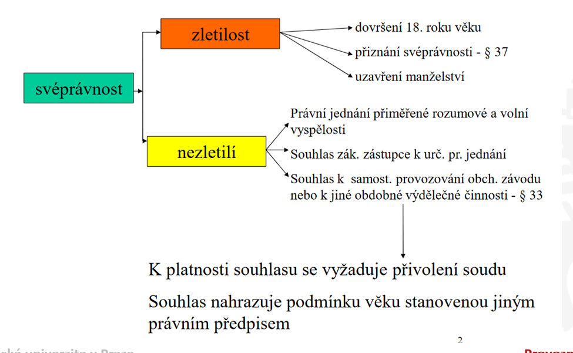
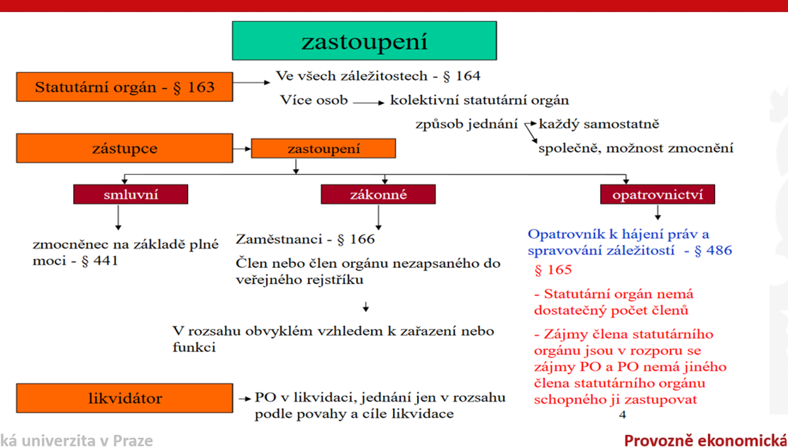
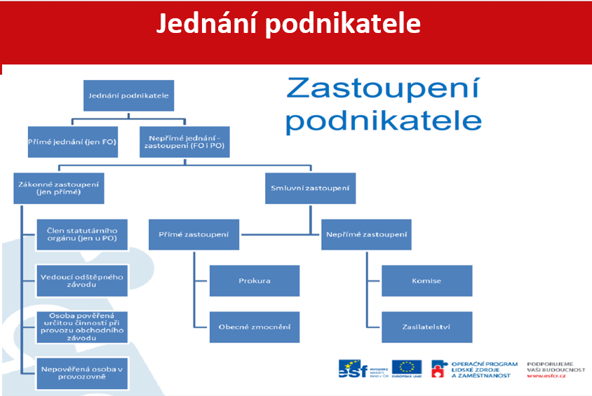

# 🏛️ Základy právních nauk – Cvik II. přednáška
 
**Téma:** Právní vztahy, jejich předpoklady a prvky, právní skutečnosti, subjekty, předmět, ochrana subjektivních práv, NOZ, právní jednání a věci  

---

##### 🗺️ Mapa témat
```text
.
└── CVIK_II_PREDNASKA/
    ├── 01_PRAVNI_VZTAHY_A_SKUTECNOSTI/
    │   ├── Předpoklady právního vztahu (norma + právní skutečnost)
    │   ├── Čtyři typy právních skutečností (jednání, protiprávní jednání, událost, stav)
    │   └── Klasifikace právních úkonů / jednání (vůle, projev, strany)
    │
    ├── 02_PRVKY_PRAVNIHO_VZTAHU/
    │   ├── Subjekt: Fyzické osoby (právní osobnost, svéprávnost, deliktní způsobilost)
    │   ├── Subjekt: Právnické osoby (korporace, fundace, ústavy)
    │   ├── Objekt: Věci, práva, hodnoty osobnosti
    │   └── Obsah: Práva a povinnosti (dare, facere, omitere, pati)
    │
    ├── 03_PRAVNI_JEDNANI_V_NOZ/
    │   ├── Návrat k terminologii "jednání" (negotium)
    │   ├── Autonomie vůle a konsenzus jako základ
    │   ├── Standard průměrného člověka (§ 4) a odborné péče (§ 5)
    │   ├── Zdánlivé jednání / nicotnost (§ 551–554)
    │   ├── Výklad právního jednání (§ 555–558) a forma (§ 559–564)
    │   └── Neplatnost právního jednání (Absolutní vs. Relativní)
    │
    ├── 04_NOVY_OBCANSKY_ZAKONIK_NOZ/
    │   ├── Vznik, účinnost (1. 1. 2014) a zrušení 238 předpisů
    │   ├── 8 základních principů NOZ (§ 3 odst. 2 a násl.)
    │   └── Struktura NOZ (5 částí, 3 081 paragrafů)
    │
    ├── 05_FYZICKE_OSOBY_V_NOZ/
    │   ├── Právní osobnost vs. Svéprávnost (emancipace § 37, omezení § 55)
    │   ├── Změna pohlaví (§ 34)
    │   ├── Nezvěstnost (§ 66) a Domněnka smrti (§ 71)
    │   ├── Ochrana osobnosti, podoby a soukromí (§ 81–90)
    │   └── Integrita lidského těla a nakládání s lidským tělem za života i po smrti (§ 91–117)
    │
    ├── 06_PRAVNICKE_OSOBY_V_NOZ/
    │   ├── Korporace (spolky, obchodní společnosti)
    │   ├── Fundace (nadace, nadační fondy)
    │   ├── Ústavy (spojení osobní a majetkové složky)
    │   └── Vznik, zakladatelské jednání, zastoupení a zrušení s likvidací
    │
    ├── 07_ZASTOUPENI_A_PROKURA/
    │   ├── Zástupčí oprávnění a překročení
    │   ├── Smluvní zastoupení (Plná moc)
    │   ├── Prokura (§ 450–456) – podnikatelské zmocnění
    │   └── Zákonné zastoupení a Opatrovnictví FO a PO
    │
    └── 08_VECI_A_JEJICH_ZAKLADNI_CLENENI/
        ├── Pojem věci (§ 489 NOZ) – co JE a co NENÍ věcí (živé zvíře, lidské tělo)
        ├── Třídění věcí (hmotné/nehmotné, movité/nemovité, zastupitelné/nezastupitelné)
        ├── Součást věci (§ 505) vs. Příslušenství (§ 510)
        ├── Superficiální zásada (*Superficies solo cedit* § 506)
        └── Plody (*fructus naturales*) vs. Užitky (*fructus civiles*)
```

---

#### 📖 Základní pojmy
⚖️ **Právní vztah** – Společenský vztah regulovaný právní normou, v němž vystupují subjekty s komplementárními právy a povinnostmi.  
🧱 **Právní skutečnost** – Okolnost právně významná, s níž právní norma spojuje vznik, změnu nebo zánik právního vztahu.  
👤 **Právní osobnost** – Způsobilost mít v mezích právního řádu práva a povinnosti (od narození do smrti).  
✍️ **Svéprávnost** – Způsobilost nabývat pro sebe vlastním právním jednáním práva a zavazovat se k povinnostem (vzniká zletilostí v 18 letech).  
🚫 **Zdánlivé právní jednání (Nicotnost)** – Jednání, které nesplňuje základní náležitosti právního jednání (chybí vůle, vážnost nebo určitost); nepřihlíží se k němu.  
📜 **Prokura** – Zvláštní druh smluvního zastoupení zapsaného podnikatele k úkonům při provozu obchodního závodu.  
🏞️ **Superficiální zásada** – Zásada *Superficies solo cedit* („stavba je součástí pozemku“).  

---

### 🏛️ 1. Právní vztahy a právní skutečnosti

# Právní vztahy

<span style="color:red">**Právní vztah**</span> = Běžný společenský vztah, na který se vztahuje právo.

**Předpoklady vzniku (Základní rovnice):**
Aby právní vztah vůbec vznikl, musí se potkat 2 věci:
1. <span style="color:red">**Existence Právní normy**</span> (Teoretické pravidlo - např. zákoník definuje, jak funguje převod nemovitosti).
2. <span style="color:red">**Právní skutečnost**</span> (Praktický spouštěč - např. reálný podpis kupní smlouvy).

**Prvky právního vztahu:**
Každý vztah se skládá ze tří částí: <span style="color:red">**subjekt**</span> (kdo), <span style="color:red">**objekt**</span> (čeho se to týká) a <span style="color:red">**obsah**</span> (jaká mají práva a povinnosti).

**Příklad:**
Existuje občanský zákoník (právní norma). Ty podepíšeš smlouvu o koupi auta (právní skutečnost). Tím se stáváš kupujícím (subjekt) s právem auto dostat a povinností zaplatit (obsah), přičemž samotné auto je objekt.


# Právní skutečnosti

<span style="color:red">**Právní skutečnost**</span> = Reálná životní situace, se kterou právo spojuje vznik, změnu nebo zánik právního vztahu.

Dělí se podle dvou hlavních kritérií:
1. **Lidská vůle:** Subjektivní (závislé na vůli – chci to) vs. Objektivní (nezávislé na vůli – stalo se to samo).
2. **Soulad s právem:** V souladu (legální) vs. V rozporu (nelegální).

Z toho logicky vznikají **4 základní typy** (to nejdůležitější ze slidu):

Když je to v souladu s právem myslí se v souladu s Objektivním právem, když v rozporu s Objektivním právem

| | **Závislé na vůli** (Subjektivní) | **Nezávislé na vůli** (Objektivní) |
| :--- | :--- | :--- |
| **V souladu s právem** | <span style="color:red">**Právní jednání**</span><br>(Př.: uzavření smlouvy, sepsání závěti) | <span style="color:red">**Právní událost**</span><br>(Př.: narození, smrt, uplynutí času) |
| **V rozporu s právem** | <span style="color:red">**Protiprávní jednání**</span><br>(Př.: spáchání přestupku, porušení smlouvy) | <span style="color:red">**Protiprávní stav**</span><br>(Př.: nemoc, pracovní úraz, živelní pohroma) |

**Důležitý detail k protiprávnímu jednání:** 
Porušit zákon (jednat protiprávně) můžeš dvěma způsoby:
- **Konáním:** Uděláš něco, co se nesmí.
- **Opomenutím:** Neuděláš něco, co ti zákon výslovně přikazuje.

# Právní úkony

<span style="color:red">**Právní úkon**</span> = Projev vůle navenek, se kterým právo spojuje nějaké následky.

**4 ZLATÁ PRAVIDLA PLATNOSTI (Základ pro zkoušku):**
Aby úkon platil a nebyl neplatný (absolutně(od začátku neplanté) či relativně(platné dokud si nebudeme stěžovat)), musí být projev vůle učiněn (**všechny 4 podmínky musí být splněny kumulativně/současně!**):
1. <span style="color:red">**Svobodně**</span> (bez donucení nebo nátlaku)
2. <span style="color:red">**Vážně**</span> (nesmí to být myšleno v legraci nebo jako nadsázka)
3. <span style="color:red">**Určitě**</span> (musí být přesně jasné, čeho se úkon týká)
4. <span style="color:red">**Srozumitelně**</span> (projev musí být objektivně pochopitelný pro okolí)

**Jak lze vůli projevit:**
- <span style="color:red">**Výslovně**</span> – slovy (ústně nebo písemně).
- <span style="color:red">**Konkludentně**</span> – tzv. mlčky nebo činem (např. nastoupení do tramvaje nebo položení nákupu na pás – nic neřekneš, ale uzavíráš tím přepravní/kupní smlouvu).

**Dělení podle počtu stran:**
- <span style="color:red">**Jednostranné**</span> – stačí vůle jednoho subjektu (závěť, podání výpovědi, vydědění).
- <span style="color:red">**Dvou a vícestranné**</span> – musí dojít ke shodě 2 nebo více stran (typicky všechny smlouvy).

# Rozdělení právních úkonů a smluv

### 1. Dle způsobu projevu vůle
- **Konáním:**
  - <span style="color:red">**Výslovně**</span> – slovním vyjádřením (ústně nebo písemně).
  - <span style="color:red">**Konkludentně**</span> – chováním nebo činem (kývnutí hlavou, roztrhání listiny, nástup do MHD, nákup z automatu).
- **Nekonáním:** Pasivitou nebo opomenutím (tam, kde byla povinnost konat).

### 2. Dle úplatnosti
- <span style="color:red">**Úplatné**</span> – poskytuje se protiplnění (např. kupní smlouva).
- <span style="color:red">**Bezplatné**</span> – bez protiplnění (např. darovací smlouva).
- <span style="color:red">**Smíšené**</span> – úplatné, ale za zcela symbolickou cenu.

### 3. Dle zákonné úpravy (Klíčové ke zkoušce)
- <span style="color:red">**Pojmenované (nominátní)**</span> – zákon je výslovně upravuje a má pro ně přesný název (kupní, nájemní, smlouva o dílo).
- <span style="color:red">**Nepojmenované (inominátní)**</span> – zákonem přímo neupravené (atypické) smlouvy; lze je libovolně vytvořit na základě smluvní volnosti, pokud neodporují obsahu nebo účelu zákona.  

# Prvky právního vztahu: I. Subjekt

<span style="color:red">**Subjekt právního vztahu**</span> = Každý, kdo může mít práva a povinnosti (fyzická nebo právnická osoba).

---

### 1. Fyzická osoba (Člověk)
U fyzických osob se rozlišují **3 základní způsobilosti**:

- <span style="color:red">**Právní osobnost**</span> *(způsobilost mít práva a povinnosti)*
  - **Trvání:** Od narození do smrti.
  - **Pravidlo:** Má ji úplně každý. **Nelze ji omezit ani odejmout!**

- <span style="color:red">**Svéprávnost**</span> *(způsobilost vlastním právním jednáním zakládat práva a povinnosti)*
  - **Vznik:** Zletilostí v 18 letech (výjimečně od 16 let se souhlasem soudu).
  - **Pravidlo:** Lze ji **omezit soudem** (např. z duševních příčin).

- <span style="color:red">**Deliktní způsobilost**</span> *(způsobilost nést odpovědnost za protiprávní jednání / škodu)*
  - **Vznik:** Dosažením **15 let** věku.

---

### 2. Právnická osoba (Umělá entita)
- **Definice:** Umělá (fiktivní) osoba vytvořená právem.
- **Příklady:** Obchodní společnosti (s.r.o., a.s., v.o.s., k.s.), veřejné VŠ, družstva, komory, ČT, ČRo.
- **Vznik:**
  - **Ze zákona** (přímo schválením konkrétního zákona – např. obce, kraje, ČT).
  - **Na základě zákona** (založením zakladatelskou smlouvou + **zápis do rejstříku** – např. běžné firmy).

  # Prvky právního vztahu: II. Objekt a III. Obsah

### Právnickými osobami mohou být:
- **Korporace** – sdružení osob (např. spolky, firmy).
- **Nadace a fondy** – majetkové celky určené k určitému účelu.
- **Jednotky územní samosprávy** – obce a kraje.
- **Jiné subjekty** stanovené zákonem.

---

### II. Objekt právního vztahu
<span style="color:red">**Objekt**</span> = To, k čemu směřují vzájemná práva a povinnosti subjektů (předmět vztahu).
- **Příklady:** věci (auto, dům), práva, vynálezy, autorská díla, ochrana osobnosti.

---

### III. Obsah právního vztahu (Klíčové ke zkoušce)
<span style="color:red">**Obsah**</span> = Souhrn práv a povinností obou stran.
- **Vzájemná podmíněnost:** Právo jedné strany odpovídá povinnosti druhé strany (a naopak).

**4 základní typy právních povinností (dare, facere, omittere, pati):**
1. <span style="color:red">**Něco dát**</span> (*dare*) – např. zaplatit kupní cenu, předat zboží.
2. <span style="color:red">**Něco konat**</span> (*facere*) – např. opavit střechu, provést službu.
3. <span style="color:red">**Něčeho se zdržet**</span> (*omittere*) – např. nekácet stromy u souseda, nekonkurovat firmě.
4. <span style="color:red">**Něco strpět**</span> (*pati*) – např. strpět průchod souseda přes vlastní pozemek (věcné břemeno).



# Svéprávnost

<span style="color:red">**Svéprávnost**</span> se nabyde buď **zletilostí** (plná svéprávnost), nebo v omezeném rozsahu v **nezletilosti**.

---

### 1. Zletilost (Plná svéprávnost)
Plnou svéprávnost lze nabýt **3 způsoby**:
- <span style="color:red">**Dovršením 18. roku věku**</span> (standardní cesta).
- <span style="color:red">**Přiznáním svéprávnosti souder**</span> (tzv. *emancipace* od 16 let – § 37).
- <span style="color:red">**Uzavřením manželství**</span> (se souhlasem soudu od 16 let; nabytá svéprávnost zůstává i při případném rozvodu).

---

### 2. Nezletilí (Částečná svéprávnost)
Nezletilý nemá plnou svéprávnost, ale může právně jednat ve **3 úrovních**:
1. <span style="color:red">**Běžná jednání:**</span> Samostatně může dělat úkony přiměřené jeho rozumové a volní vyspělosti (např. nákup jídla, lístku na MHD).
2. <span style="color:red">**Jednání se souhlasem zákonného zástupce:**</span> Rodič dá souhlas k určitému konkrétnímu úkonu (např. koupě drahého telefonu).
3. <span style="color:red">**Podnikání / Výdělečná činnost (§ 33):**</span> Nezletilý může samostatně provozovat obchodní závod nebo pracovat, pokud:
   - Má souhlas **zákonného zástupce** (rodiče).
   - Tento souhlas je schválen **soudem** (k platnosti se vyžaduje přivolení soudu).
   - *Tento souhlas nahrazuje věkovou hranici stanovenou jinými předpisy.*

   

   # Zastoupení a jednání za právnickou osobu (PO)

### 1. Statutární orgán (§ 163, § 164)
- Jedná za právnickou osobu **ve všech záležitostech**.
- Pokud je tvořen více osobami = **kolektivní statutární orgán**.
- **Způsob jednání:**
  - Každý samostatně, NEBO
  - Společně (případně možnost zmocnění jednoho člena).

---

### 2. Druhy zastoupení (Klíčové k rozlišení)

* <span style="color:red">**Smluvní zastoupení**</span> (§ 441)
  - Vzniká na základě dohody.
  - Zástupce = **zmocněnec** na základě **plné moci**.

* <span style="color:red">**Zákonné zastoupení**</span> (§ 166)
  - Vzniká přímo ze zákona na základě pozice v organizaci.
  - Týká se **zaměstnanců** nebo členů orgánů.
  - Rozsah: **V rozsahu obvyklém vzhledem k jejich zařazení nebo funkci** (např. prodavač u pokladny zastupuje obchod při prodeji).

* <span style="color:red">**Opatrovnictví**</span> (§ 165, § 486)
  - Jmenuje ho soud k hájení práv a spravování záležitostí PO.
  - **Kdy se jmenuje opatrovník:**
    - Statutární orgán nemá dostatečný počet členů.
    - Zájmy člena statutárního orgánu jsou v rozporu se zájmy PO a není jiný schopný člen.

---

### 3. Likvidátor
- Jedná za právnickou osobu, která je **v likvidaci**.
- Rozsah jednání je omezen pouze na účel a povahu **likvidace** (rozprodání majetku, vyrovnání dluhů).

# Zásady a principy NOZ (Změny oproti staré úpravě)

### 1. Změna terminologie
- NOZ opouští starý termín **právní úkon** (považovaný za slovakismus) a vrací se k tradičnímu římskoprávnímu pojmu <span style="color:red">**právní jednání**</span> (*negotium*).

---

### 2. Zrušení "zásady rovnosti stran"
- NOZ výslovně **NEobsahuje** formální <span style="color:red">**zásadu rovnosti stran/osob**</span>.
- **Důvody:**
  - Formální rovnost zastírá reálnou přirozenou nerovnost mezi lidmi a firmami (rovnosti nelze nikdy plně dosáhnout).
  - Přehnaná snaha o "rovnost" narušovala přirozenou svobodu člověka.

---

### 3. Hlavní myšlenka (Klíčové ke zkoušce)
- <span style="color:red">**Autonomie vůle**</span> a **přirozená svoboda člověka** má přednost před státem.
- Stát není tvůrcem svobody člověka, ale pouze jejím **ochráncem**.

# Zásada autonomie vůle a vybrané principy NOZ

### 1. Zásada autonomie vůle
- Každý má možnost svobodně se rozhodnout, s kým, jak, kdy a za jakých podmínek bude právně jednat.
- **Konsenzus** (dohoda dvou stran) je základním nástrojem soukromého práva.
- Smluvní svobodě se dává maximální prostor.
- Zákon funguje jako <span style="color:red">**ultima ratio**</span> (poslední možnost) – nastupuje až tehdy, pokud dohoda není možná nebo k ní nedojde.

---

### 2. Důležité právní domněnky a standardy (§ 4 a § 5 NOZ)

* <span style="color:red">**§ 4 NOZ – Průměrný člověk**</span>
  - Má se za to, že každá svéprávná osoba má **rozum průměrného člověka** a je schopna jej užívat s běžnou péčí a opatrností.
  - V právním styku se toto očekává od každého.
  - Slouží ke stanovení minimální předvídatelnosti – u soudu neobstojí výmluva „ja jsem to nevěděl“, pokud by to průměrný člověk vědět měl a mohl.

* <span style="color:red">**§ 5 NOZ – Odborná péče (Profesionál)**</span>
  - Kdo se veřejně přihlásí k určitému povolání nebo stavu jako odborník, dává tím najevo, že je schopen jednat se **znalostí a pečlivostí**, která je s tímto povoláním spojena.
  - Pokud jako odborník pochybí, odpovídá za škodu přísněji než běžný člověk (klíčové pro **náhradu škody**).

  # Zdánlivé právní jednání (§ 551 a násl. NOZ)

<span style="color:red">**Zdánlivé právní jednání (nicotnost)**</span> = Jednání, které jako právní úkon jen vypadá, ale ve skutečnosti právně **vůbec neexistuje** (hledí se na něj, jako by se nikdy nestalo).

---

### Kdy jde o zdánlivé jednání (Kdy právní jednání CHYBÍ):
1. <span style="color:red">**Chybí vůle**</span> jednající osoby.
2. <span style="color:red">**Nebyla zjevně projevena vážná vůle**</span> (např. vtip, nadsázka, v divadelní hře).
3. <span style="color:red">**Neurčitost nebo nesrozumitelnost**</span> – nelze zjistir obsah ani výkladem.

---

### Důležitá výjimka (Dodatečné vyjasnění - § 553 odst. 2 NOZ):
- Pokud si strany neurčitý nebo nesrozumitelný projev vůle **dodatečně vyjasní**, vada mizí.
- Hledí se na to, jako by tu platné právní jednání bylo **od počátku**.

---

### Základní následek:
- <span style="color:red">**K zdánlivému právnímu jednání se nepřihlíží!**</span> (Nemá žádné právní následky, není potřeba se u soudu dovolávat neplatnosti).  

# Výklad právního jednání (§ 555 a násl. NOZ)

### 1. Zlaté pravidlo výkladu
- <span style="color:red">**Právní jednání se posuzuje podle svého obsahu, a ne podle slov.**</span>
- Klade se důraz na **skutečnou vůli** jednajících osob a opouští se přísně formální hledisko samotného projevu.

---

### 2. Zastřené právní jednání (§ 555 odst. 2 NOZ)
- Má-li být jedním právním jednáním zastřeno jiné právní jednání, posoudí se podle jeho <span style="color:red">**pravé povahy**</span> (tj. podle toho, co strany skutečně chtěly, ne co předstíraly).
- **Příklad:** Smlouva se tváří jako „darovací“ (aby se neplatily daně), ale ve skutečnosti si za věc tajně předají peníze. Právo to posoudí jako kupní smlouvu.

---

### 3. Pravidlo v pochybnostech (§ 557 NOZ - contra proferentem)
- Připouští-li použitý výraz různý výklad, vyloží se v pochybnostech <span style="color:red">**k tíži toho, kdo výrazu použil jako první**</span>.
- Autor nejasného textu (např. banka nebo firma připravující smlouvu) nese riziko za jeho nejednoznačnost.

# Forma a neplatnost právního jednání (§ 559 a § 574 a násl. NOZ)

### 1. Forma právního jednání
- <span style="color:red">**Zásada bezformálnosti (§ 559 NOZ):**</span> Každý má právo zvolit si **libovolnou formu** právního jednání (ústně, písemně, konkludentně), pokud není omezena zákonem nebo dohodou stran.
- <span style="color:red">**Povinná písemná forma (§ 560 NOZ):**</span> Vyžaduje se pro **zřízení, převod, změnu nebo zrušení věcného práva k nemovité věci** (např. kupní nebo darovací smlouva na dům/pozemek).
  - Projev vůle všech účastníků musí být **na téže listině**.

---

### 2. Neplatnost právního jednání (§ 574 a násl. NOZ)
- <span style="color:red">**Pravidlo zachování jednání (§ 574 NOZ):**</span> **„Jednání je spíše platné než neplatné.“** (Soudy se mají snažit hledat výklad, který smlouvu zachová, než ji rušit).
- <span style="color:red">**Ústup od absolutní neplatnosti:**</span> Nová úprava opouští dřívější automatickou absolutní neplatnost. Převažuje **relativní neplatnost** a absolutní nastává jen ve zcela výjimečných případech (při porušení veřejného pořádku nebo dobrých mravů).

# Absolutní neplatnost

**Absolutní neplatnost** = Právní jednání je neplatné **od samého počátku** a nemá žádné právní účinky (hledí se na něj, jako by vůbec nevzniklo).

---

### Důvody absolutní neplatnosti (Kdy nastává):
- **Zjevně porušuje dobré mravy**.
- **Porušuje zákon** (pokud smysl a účel zákona absolutní neplatnost vyžaduje – ochrana veřejného pořádku, ochrana nezletilých apod.).
- **Zjevně se příčí veřejnému pořádku**.

---

### Klíčové vlastnosti a účinky:
- **Působí *ex tunc*** = Neplatné od samého počátku (zpětně).
- **Postoj soudu:** Soud k ní přihlíží **z úřední povinnosti** (přihlíží k ní sám, i bez návrhu).
- **Kdo ji může namítnout:** Kdokoliv.
- **Nelze zhojit:** Nelze ji dodatečně schválit ani opravit.

---

### Příklad:
- Smlouva o prodeji lidských orgánů nebo nájemných vraždách (v rozporu s dobrými mravy a veřejným pořádkem).

# Relativní neplatnost

**Relativní neplatnost** = Právní jednání se považuje za **platné**, dokud se jeho neplatnosti oprávněná osoba výslovně nedovolá (chrání zájem konkrétního člověka).

---

### Důvody relativní neplatnosti (Kdy nastává):
- Jednání v **tísni nebo za nápadně nevýhodných podmínek**.
- Uzavřeno osobou, která **nebyla plně svéprávná** (ale nebyla svéprávnosti zcela zbavena).
- Uzavřeno **v omylu** ohledně podstatných náležitostí smlouvy.

---

### Klíčové vlastnosti a účinky:
- **Působí *ex nunc*** = Uplatňuje se až od okamžiku, kdy ji dotčená osoba namítne. Do té doby smlouva normálně platí.
- **Postoj soudu:** Soud k ní **z vlastní iniciativy nepřihlíží** (musí být namítnuta dotčenou stranou).
- **Kdo ji může namítnout:** Pouze dotčená / poškozená osoba.
- **Možnost zhojení:** Lze ji zhojit (např. dodatečným souhlasem nebo tím, že na neplatnosti poškozený netrvá).

---

### Příklad:
- Prodávající uvede kupujícího v omyl, že prodávané auto nebylo nikdy havarované. Kupující má právo namítnout relativní neplatnost a žádat zrušení smlouvy. Pokud to neudělá, smlouva zůstává platná.

# Absolutní neplatnost – Domáhání a procesní postup

### 1. Jak se domáhat
- Není nutné se jí aktivně domáhat soudně – **soud k ní přihlíží z úřední povinnosti** (*ex officio*).
- Stačí, když **kdokoliv** (účastník i třetí osoba) na neplatnost upozorní.
- Zjistí-li soud důvod absolutní neplatnosti, přihlédne k němu **automaticky i bez návrhu**.

---

### 2. Kdo může namítat
- **Kterákoli osoba** – nejen účastníci smlouvy, ale i třetí osoby (např. orgány veřejné správy).
- **Soud sám o sobě**, pokud zjistí rozpor se zákonem, dobrými mravy nebo veřejným pořádkem.

---

### 3. Způsob nápravy / Obrana
- Soud rozhodne, že jednání je absolutně neplatné.
- Pokud se někdo snaží vymáhat práva z neplatného jednání, řeší se to **zápůrčí žalobou** (bránění se neoprávněným nárokům).  

# Relativní neplatnost – Domáhání a procesní postup

### 1. Jak se domáhat
- Musí být **aktivně namítnuta** dotčenou osobou – pokud se nenamítne, jednání zůstává platné a účinné.
- Realizuje se nejčastěji **podáním žaloby** k soudu (např. žaloba na určení neplatnosti).
- Musí být namítnuta v **přiměřené lhůtě** (v praxi do **3 let** od okamžiku, kdy se osoba o důvodu neplatnosti dozvěděla – promlčecí lhůta dle § 629 a násl. NOZ).

---

### 2. Kdo může namítat
- **Pouze oprávněná osoba** (dotčený účastník smlouvy, který byl vankem vady poškozen – např. osoba uvedená v omyl nebo jednající v tísni).
- Třetí osoby ani soud z vlastní iniciativy ji namítat nemohou.

---

### 3. Způsob nápravy
- Soud rozhodne o neplatnosti **pouze na návrh** oprávněné osoby.
- Pokud oprávněná osoba neplatnost nenamítne, právní jednání trvale zůstává **platné a účinné**.

# Zdánlivé právní jednání (Nicotné právní jednání)

**Zdánlivé (nicotné) jednání** = Jednání, které jako právní úkon jen vypadá, ale ve skutečnosti právně **vůbec nevzniklo** a nemá žádné právní následky.

---

### Klíčové vlastnosti:
- **Přejití od absolutní neplatnosti:** NOZ omezil masivní absolutní neplatnost a nahradil ji konceptem nicotnosti (zdánlivosti).
- **Nepřihlíží se k němu (§ 554 NOZ):** Hledí se na něj, jako by se nikdy nenastalo.
- **Konvalidace (Dodatečné zhojení):** Pokud si strany nejasný projev vůle **dodatečně vyjasní**, vada mizí a hledí se na něj jako na platné jednání **od počátku**.

---

### O zdánlivé jednání jde, pokud (§ 551–554 NOZ):
1. **Chybí vůle** jednající osoby.
2. **Nebyla vůle zjevně projevena** (vtip, nadsázka, výuka, divadlo).
3. **Pro neurčitost nebo nesrozumitelnost** nelze zjistit obsah ani výkladem.
4. **Zákon výslovně stanoví**, že se k určitému jednání nepřihlíží.

# Právní jednání (§ 545 a násl. NOZ)

**Právní jednání** = Právní skutečnost (projev vůle), která vyvolává právní následky vyjádřené v jednání, ale i následky plynoucí ze zákona, dobrých mravů, zvyklostí a zavedené praxe stran.
- *Příklad:* Rozhodnutí valné hromady nebo jediného společníka.

---

### Rozlišení: Vznik vs. Platnost právního jednání (Klíčové ke zkoušce)

- **Podmínky pro VZNIK:**
  - Musí existovat **vážná**, **dostatečně srozumitelná** a **určitá vůle** jednajícího.
  - *Chybí-li tyto náležitosti, jednání vůbec nevznikne (jde o zdánlivé/nicotné jednání).*

- **Náležitosti pro PLATNOST:**
  1. **Náležitost subjektu:** Svéprávnost.
  2. **Náležitost projevu:** Dodržení formy (např. písemná u nemovitostí).
  3. **Náležitost vůle:** Svoboda a absence omylu.
  4. **Náležitost předmětu:** Dovolenost a možnost plnění.

---

### Způsoby právního jednání (§ 546 NOZ)
- **Konáním** nebo **opomenutím**.
- **Výslovně** (písemně/ústně) nebo **jiným způsobem nevzbuzujícím pochybnost** (konkludentně – např. kývnutí hlavou, gestem, nákup z automatu).

# Základní informace k NOZ

**Nový občanský zákoník (NOZ)** = Zákon č. **89/2012 Sb.**, účinný od **1. ledna 2014** (nahradil starý zákoník z roku 1964). Základní předpis soukromého práva v ČR.

---

### Hlavní cíle NOZ (Klíčové ke zkoušce)

1. **Kodifikace a sjednocení:** Sloučení občanského, rodinného a obchodního práva do jednoho zákoníku.
2. **Posílení smluvní autonomie:** Vyšší svoboda pro ujednání mezi stranami.
3. **Ochrana slabší strany:** Ochrana spotřebitelů, nezletilých a osob se sníženou schopností právně jednat.
4. **Reflexe moderních hodnot:** Důraz na ochranu lidské důstojnosti a osobnosti.
5. **Návrat k tradici:** Inspirace prvorepublikovou úpravou a tradiční právní terminologií.


# Základní principy NOZ

Základní zásady vyjadřují filozofii NOZ a uplatňují se při výkladu zákona i rozhodování soudů.

---

### 1. Zásada autonomie vůle (smluvní svobody)
- Účastníci si mohou libovolně dohodnout vlastní pravidla, práva a povinnosti.
- Omezení je možné jen tehdy, pokud to zákon výslovně stanoví (např. ochrana slabší strany).

### 2. Zásada poctivosti a dobré víry
- Každý má povinnost jednat poctivě a v dobré víře.
- **Zákaz zneužití práva:** Nelze se dovolávat práva, pokud by to vedlo ke zjevné nespravedlnosti.

### 3. Zásada ochrany dobrých mravů a veřejného pořádku
- Právní jednání nesmí odporovat společenským hodnotám (dobrým mravům) a veřejnému pořádku.
- **Soud přihlíží k těmto zásadám i bez návrhu (z úřední povinnosti).**

### 4. Zásada ochrany slabší strany
- Zajišťuje, že slabší strany (spotřebitelé, nájemci, zaměstnanci) nebudou znevýhodněny.
- V případě pochybností se právo interpretuje **ve prospěch slabší strany**.

# Základní principy NOZ (pokračování)

### 5. Zásada právní jistoty a předvídatelnosti práva
- Účastníci mají právo spoléhat na stabilitu právního řádu a ochranu svých práv.
- Výklad právních norem musí být pro účastníky co nejvíce předvídatelný.

### 6. Zásada ochrany důstojnosti a osobnosti
- Ochrana člověka jako jednotlivce a jeho základních lidských práv a svobod.
- Zajišťuje respekt k lidské důstojnosti, životu, zdraví, cti, soukromí a rodinnému životu.

### 7. Zásada *pacta sunt servanda* (Smlouvy se mají dodržovat)
- Strany jsou povinny řádně plnit své smluvní závazky.
- Důraz na stabilitu a důvěryhodnost smluvních vztahů.

### 8. Zásada dispozitivnosti
- Většina ustanovení NOZ má **dispozitivní povahu** = účastníci si mohou sjednat odlišná pravidla, pokud to zákon výslovně nezakazuje.
- **Kogentní normy** (donucující pravidla) se použijí jen tehdy, pokud je nutné chránit veřejný zájem, dobré mravy nebo slabší stranu.

# Struktura NOZ

Občanský zákoník je rozdělen do **5 hlavních částí**:

1. **Obecná část** (§ 1–302) – upravuje základní ustanovení, právní jednání, zastoupení a právnické osoby.
2. **Rodinné právo** (§ 655–975) – zahrnuje úpravu manželství, rodičovských práv a povinností a jiných příbuzenských vztahů.
3. **Absolutní majetková práva** (§ 976–1474) – věnuje se vlastnickému právu, věcným právům, držbě a sousedským vztahům.
4. **Relativní majetková práva** (§ 1721–3014) – smluvní závazky, odpovědnost za škodu, dědické právo.
5. **Ustanovení společná, přechodná a závěrečná** (§ 3015–3081).

# Nové termíny k vlastnictví a dalším věcným právům

- **ROZHRADY** – Ploty, zdi, meze, strouhy oddělující pozemky.
- **PŘIVLASTNĚNÍ** – Nabytí věci, která nikomu nepatří (pokud to zákon dovoluje).
- **PŘESTAVEK** – Trvalá stavba zřízená na vlastním pozemku zasahuje malou částí na cizí pozemek.
- **PRÁVO STAVBY** – Věcné právo opravňující mít na cizím pozemku stavbu (stavba sama o sobě nemusí zatím existovat).
- **SLUŽEBNOST** – Vlastník zatížené věci musí něco strpět nebo se něčeho zdržet (např. právo okapu, právo pastvy, právo na vodu, inženýrské sítě).
- **BENEFICIENT** – Osoba, v jejíhož prospěch je majetek spravován.
- **SVĚŘENECKÝ FOND** – Samostatné vyčlenění majetku, který zůstává bez vlastníka a je spravován správcem za určitým účelem.
- **OBMYŠLENÝ** – Určená osoba, které má být ze svěřeneckého fondu poskytováno plnění.

# Nové termíny závazkového práva

- **ZÁVDAVEK** – (Není záloha) Potvrzuje uzavření smlouvy a poskytuje jistotu, že závazek bude splněn.
- **ODVOLÁNÍ DARU PRO NOUZI** – Možnost dárce požadovat vrácení daru nebo jeho peněžní náhradu při upadnutí do nouze.
- **VÝPROSA** – Bezplatné a bezúčelné přenechání věci k užívání výprosníkovi bez sjednání doby (lze požadovat kdykoliv zpět).
- **PACHT** – Přenechání věci k dočasnému užívání a požívání (přinášení výnosů) za pachtovné nebo část výnosu.
- **VÝMĚNEK** – Práva vymíněná původním vlastníkem nemovitosti při jejím převodu (např. doživotní užívání bytu, zaopatření).
- **ODVÁŽNÉ SMLOUVY** – Smlouvy, kde prospěch nebo neprospěch závisí na nejisté budoucí události (např. pojištění, sázka, hra).

# Obecné informace k Občanskému zákoníku

- **Rozsah:** Nový občanský zákoník obsahuje celkem **3 081 paragrafů**.
- **Velká rekodifikace:** Přejímá úpravu z více než 100 zrušených právních předpisů (např. obchodní zákoník, zákon o rodině, zákon o vlastnictví bytů).
- **Modernizace a zpřesnění:** Přizpůsobuje pravidla moderním potřebám a doplňuje chybějící úpravu pro praxi.
- **Struktura zákoníku:** Člení se na **hlavy, díly a oddíly**.
- **Legislativní pravidlo přehlednosti:**
  - Jeden paragraf = **max. 2 odstavce**.
  - Jeden odstavec = **max. 2 věty**.
  *(Pravidlo nebylo možné dodržet v 100 % případů).*

# Systematika a jazyk Občanského zákoníku

### 1. Řazení institutů
- Příbuzné a tematické instituty jsou řazeny **od jednodušších ke složitějším** a **od obecných ke zvláštním**.
- Hledisko důležitosti se nepoužívá, protože důležitost je relativní.

---

### 2. Jazyková preference a purismus
- **Česká slova mají přednost:** Preferují se česká slova před cizími (*zapsaný* místo *registrovaný*, *nakládat* místo *disponovat*, *sdělení/údaj* místo *informace*).
- **Bez přemrštěného purismu:** Cizí termíny se ponechávají tam, kde zdomácněly (*orgán*, *forma*, *elektronický*) nebo kde mají přesný právní význam (*prekluze*, *detence*).

---

### 3. Návrat k tradiční právní terminologii
NOZ opouští slovakismy a totalitní neologismy z let 1950 a 1964:

- **osoba** (místo *účastník*)
- **svéprávnost** (místo *způsobilost k právním úkonům*)
- **nabídka** (místo *návrh na uzavření smlouvy*)
- **společenská smlouva** (místo *smlouva o sdružení*)

# Fyzické osoby – Právní osobnost a svéprávnost

### 1. Právní osobnost
- **Způsobilost mít v mezích právního řádu práva a povinnosti** (nahrazuje starší pojem *způsobilost mít práva a povinnosti*).
- Vzniká **narozením** (početím u počatého dítěte – *nasciturus*, pokud se narodí živé) a zaniká **smrtí**.

---

### 2. Svéprávnost
- **Způsobilost nabývat pro sebe vlastním právním jednáním práva a zavazovat se k povinnostem** (právně jednat).
- Plně se nabývá zplnoletněním (zpravidla v 18 letech, případně přiznáním svéprávnosti nebo uzavřením manželství).

---

### 3. Základní pravidla a pojmy
- **Nezcizitelnost:** Právní osobnosti ani svéprávnosti se nikdo nemůže vzdát ani zčásti (k takovému jednání se nepřihlíží).
- **Rozdělení osob:** Osoba je buď **fyzická**, nebo **právnická**.
- **Přirozená práva:** Každý člověk má vrozená přirozená práva (nelze je zcizit ani se jich vzdát).
- **Osoba blízká:** Příbuzný v řadě přímé, sourozenec, manžel/partner, případně jiné osoby v rodinném poměru, pokud by újmu jedné druhá pociťovala jako vlastní.

# Fyzické osoby – Novinky v oblasti svéprávnosti

### 1. Nabývání svéprávnosti
- **Plná svéprávnost:** Nabývá se zplnoletněním (dosažením **18 let**) nebo uzavřením **sňatku**.
- **Emancipace (přiznání svéprávnosti):** Nezletilý může získat svéprávnost rozhodnutím soudu na vlastní návrh, pokud je schopen se sám živit a obstarávat své záležitosti.

---

### 2. Omezení svéprávnosti
- **Zákaz úplného zbavení:** Člověka nelze svéprávnosti zcela zbavit, lze ji pouze **omezit**.
- **Podmínky pro omezení:** Pouze při vážné duševní poruše, rozhodnutím soudu, na dobu **max. 3 let** a pouze tehdy, nestačí-li mírnější opatření.
- **Povinnost soudce:** Soudce musí člověka při rozhodování o jeho svéprávnosti osobně shlédnout.

---

### 3. Mírnější alternativy
- **Nápomoc při rozhodování:** Umožňuje ustanovit osobu, která za člověka nejedná, ale pomáhá mu při běžných právních jednáních a rozhodnutích bez nutnosti omezovat jeho svéprávnost.

# Fyzické osoby – Ochrana osobnosti a práva při hospitalizaci

### 1. Zesílení ochrany osobnosti
- **Chráněná práva:** Právo na život, zdraví, osobní svobodu, jméno, čest, soukromí a lidskou důstojnost.
- **Odčinění újmy:** Porušení osobnostních práv zakládá právo na přiměřené zadostiučinění.

---

### 2. Přednost peněžitého zadostiučinění
- **Přednost finanční kompenzace:** Nově se preferuje **peněžité zadostiučinění**.
- **Kdy se použije:** Poskytuje se vždy, pokud jiný způsob (např. omluva) nestačí ke skutečnému a dostatečně účinnému odčinění způsobené újmy.

---

### 3. Práva člověka zadrženého ve zdravotnickém zařízení (§ 104–109)
- **Ochrana osobní svobody:** Výslovná právní úprava nedobrovolné hospitalizace přímo v občanském zákoníku.
- **Důvod zařazení do NOZ:** Nejde pouze o zdravotnickou profesní činnost, ale o zásadní zásah do **osobní svobody člověka**, který spadá pod ochranu osobnosti.

# Fyzické osoby – Změna pohlaví

### 1. Podmínky a okamžik změny pohlaví
- **Podmínky:** Nastává chirurgickým zákrokem při současném znemožnění reprodukční funkce a přeměně pohlavních orgánů.
- **Rozhodný den:** Má se za to, že dnem změny pohlaví je den uvedený v potvrzení vydaném poskytovatelem zdravotních služeb.

---

### 2. Právní následky změny pohlaví
- **Vliv na osobní stav:** Změna pohlaví nemá vliv na osobní stav člověka ani na jeho osobní a majetkové poměry.
- **Zánik svazku:** Manželství nebo registrované partnerství však touto změnou **zaniká**.

---

### 3. Vztahy po zániku manželství
- **Děti a majetek:** O právech a povinnostech k společnému dítěti a o majetkových poměrech po zániku manželství platí obdobně ustanovení o rozvedených manželích.

# Fyzické osoby – Přiznání a omezení svéprávnosti

### 1. Přiznání svéprávnosti (Emancipace)
Soud vyhoví návrhu nezletilého na přiznání svéprávnosti, pokud jsou splněny **všechny 3 podmínky**:
- **Věk:** Nezletilý dosáhl věku **16 let**.
- **Soběstačnost:** Je osvědčena jeho schopnost sám se živit a obstarat si své záležitosti.
- **Souhlas:** S návrhem souhlasí jeho **zákonný zástupce** (rodič).

---

### 2. Omezení svéprávnosti
- **Krajní řešení (Subsidiarita):** Omezit svéprávnost lze jen tehdy, hrozila-li by člověku jinak **závažná újma** a nepostačí-li mírnější a méně omezující opatření.
- **Principy:** Pouze v zájmu daného člověka, po jeho **osobním zhlédnutí** soudcem a s plným uznáváním jeho práv a osobní jedinečnosti.
- **Pravomoc soudu:** Omezit svéprávnost může **výhradně soud**.
- **Rozsah omezení:** Soud vymezí přesný rozsah podle toho, v jaké míře člověk není pro nepřechodnou duševní poruchu schopen samostatně právně jednat.

# Fyzické osoby – Trvání a změna omezení svéprávnosti

### 1. Obtíže s dorozumíváním
- Má-li člověk pouze obtíže se dorozumívat, **není to samo o sobě důvodem** k omezení jeho svéprávnosti.

---

### 2. Doba trvání omezení svéprávnosti
- Omezení lze stanovit pro **určitou záležitost** na dobu nutnou pro její vyřízení, nebo na dobu určitou – **nejdéle však na 3 roky**.
- Uplynutím této doby právní účinky omezení **zanikají**.
- **Prodloužení omezení:** Zahájí-li se v této lhůtě řízení o prodloužení, trvají účinky původního rozhodnutí až do vydání nového, **nejdéle však 1 rok**.

---

### 3. Změna okolností a opatrovnictví
- **Změna nebo zrušení:** Změní-li se okolnosti, soud své rozhodnutí **bezodkladně změní nebo zruší** (a to i bez návrhu).
- **Návrh opatrovníka:** Osoba povolaná za opatrovníka může při rozhodování o omezení svéprávnosti navrhnout sama sebe na jmenování opatrovníkem.

# Fyzické osoby – Nezvěstnost a domněnka smrti

### 1. Nezvěstnost
- **Podmínky prohlášení:** Soud může prohlásit za nezvěstného svéprávného člověka, který **opustil své bydliště**, **nepodal o sobě zprávu** a **není známo, kde se zdržuje**.
- **Účinky prohlášení:** Soud v rozhodnutí přesně určí den, kdy nastaly účinky prohlášení nezvěstnosti.
- **Právní jednání po opuštění bydliště:** Jednání učiněná bez souhlasu nezvěstného po jeho odchodu (před prohlášením) se posuzují jako jednání s odkládací podmínkou vydání rozhodnutí.
- **Zánik účinků:** Účinky prohlášení zanikají, pokud se člověk vrátí nebo jmenuje správce svého jmění.

---

### 2. Domněnka smrti
- **Prohlášení za mrtvého:** Soud prohlásí za mrtvého člověka, o němž lze mít důvodně za to, že zemřel.
- **Iniciativa:** Děje se tak **na návrh osoby, která na tom má právní zájem**.
- **Den smrti:** Soud v rozhodnutí určí přesný den, který se pokládá za den jeho smrti.

# Fyzické osoby – Domněnka smrti a lhůty

### 1. Prohlášení nezvěstného za mrtvého
- **Vážné pochybnosti:** Byl-li člověk prohlášen za nezvěstného a vyplývají-li z okolností vážné pochybnosti, zda ještě žije, soud ho může prohlásit za mrtvého na návrh osoby s právním zájmem.
- **Určení dne smrti:** Soud určí den, který nezvěstný zřejmě nepřežil (ten se pokládá za den jeho smrti).

---

### 2. Zákonné lhůty pro prohlášení za mrtvého
- **Osoba oficiálně prohlášená za nezvěstnou:** Nejdříve po uplynutí **5 let** počítaných od konce roku, v němž došlo k prohlášení za nezvěstného.
- **Fakticky nezvěstná osoba (bez oficiálního prohlášení):** Nejdříve po uplynutí **7 let** od konce roku, v němž se objevila poslední zpráva, z níž lze usuzovat, že byla ještě naživu.
- **Osoba nezvěstná před 18. rokem věku:** Nelze ji prohlásit za mrtvou před uplynutím roku, v němž uplyne **25 let od jejího narození**.

# Fyzické osoby – Ochrana osobnosti člověka

### 1. Rozsah ochrany
- **Přirozená práva:** Chráněna je osobnost člověka včetně všech jeho přirozených práv. Každý je povinen ctít svobodné rozhodnutí člověka žít podle svého.
- **Chráněné statky:** Zejména život, důstojnost, zdraví, právo na příznivé životní prostředí, vážnost, čest, soukromí a projevy osobní povahy.

---

### 2. Nároky při neoprávněném zásahu
- **Základní nároky:** Člověk, jehož osobnost byla dotčena, má právo domáhat se toho, aby bylo od neoprávněného zásahu **upuštěno** nebo aby byl **odstraněn jeho následek**.

---

### 3. Ochrana po smrti a uplatnění právnickou osobou
- **Ochrana po smrti:** Po smrti člověka se může ochrany jeho osobnosti domáhat kterákoli z osob jemu **blízkých**.
- **Zásah související s činností v právnické osobě:** 
  - Právo na ochranu může uplatnit i tato právnická osoba.
  - Za života člověka pouze **jeho jménem a s jeho souhlasem**.
  - Souhlas není třeba, není-li člověk schopen projevit vůli (např. pro nepřítomnost nebo neschopnost úsudku).

  # Fyzické osoby – Ochrana podoby a soukromí osoby

### 1. Ochrana podoby člověka
- **Záchyt podoby:** Zachytit jakýmkoli způsobem podobu člověka tak, aby podle zobrazení bylo možné určit jeho totožnost, je možné jen s jeho svolením.
- **Rozšiřování podoby:** Rozšiřovat podobu člověka je rovněž možné jen s jeho svolením.

---

### 2. Ochrana soukromí
- **Základní pravidlo:** Nikdo nesmí zasáhnout do soukromí jiného, nemá-li k tomu zákonný důvod.
- **Zakázané zásahy:** Bez svolení člověka nelze zejména:
  - Narušit jeho soukromé prostory.
  - Sledovat jeho soukromý život.
  - Pořizovat o jeho soukromém životě zvukový nebo obrazový záznam.
  - Využívat nebo šířit záznamy o soukromém životě (pořízené jím samotným nebo třetí osobou).
- **Soukromé písemnosti:** Ve stejném rozsahu jsou chráněny i soukromé písemnosti osobní povahy.

---

### 3. Zákonná licence (výjimka ze svolení)
- Svolení **není třeba**, pokud se podobizna nebo zvukový či obrazový záznam pořídí nebo použijí k **výkonu nebo ochraně jiných práv** nebo **právem chráněných zájmů jiných osob**.


# Fyzické osoby – Právo na duševní a tělesnou integritu

### 1. Nedotknutelnost a lidské tělo
- **Nedotknutelnost:** Člověk je nedotknutelný.
- **Ochrana po smrti:** Lidské tělo podléhá právní ochraně i po smrti. Je zakázáno naložit s lidskými pozůstatky a ostatky nedůstojným způsobem.

---

### 2. Právo na vydání lidských ostatků
Nejsou-li ostatky uloženy na veřejném pohřebišti, má na jejich vydání právo postupně:
1. Osoba výslovně určená člověkem před jeho smrtí.
2. Manžel, dítě nebo rodič.
3. Dědic (pokud předchozí osoby neexistují nebo odmítnou ostatky převzít).

---

### 3. Souhlas se zásahem do integrity
- **Požadavek na souhlas:** Bez zákona nesmí nikdo zasáhnout do integrity jiného člověka bez jeho informovaného souhlasu (s vědomím o povaze zásahu a jeho následcích).
- **Neplatnost souhlasu k závažné újmě:** Souhlasí-li někdo, aby mu byla způsobena závažná újma, k takovému souhlasu se nepřihlíží.
  - *Výjimka:* Neplatí, je-li zásah podle všech okolností nutný v zájmu života.

  # Fyzické osoby – Poučení a souhlas se zákrokem

### 1. Náležité vysvětlení (Poučení o zákroku)
- **Povinnost vysvětlení:** Kdo chce na jiném provést zákrok, musí mu srozumitelně vysvětlit jeho povahu.
- **Kritéria řádného vysvětlení:** Lze-li rozumně předpokládat, že druhá strana pochopila:
  - Způsob a účel zákroku.
  - Očekávané následky i možná nebezpečí pro své zdraví.
  - Případné alternativní postupy.
- **Zastoupení:** Uděluje-li souhlas zákonný zástupce, podá se vysvětlení i samotnému dotčenému (je-li schopen úsudku) způsobem přiměřeným jeho schopnostem.

---

### 2. Forma souhlasu (Písemná forma)
Písemná forma souhlasu se vyžaduje v následujících případech:
- Má-li být oddělena **část těla, která se již neobnoví**.
- Jde-li o **lékařský pokus** na člověku.
- Jde-li o **zákrok, který zdravotní stav člověka nevyžaduje**.
  - *Výjimka:* Neplatí pro kosmetické zákroky nezanechávající trvalé nebo závažné následky.

  # Fyzické osoby – Nakládání s částmi lidského těla

### 1. Základní práva a zákazy
- **Právo na informace:** Člověk, jemuž byla odňata část těla, má právo dozvědět se, jak s ní bylo naloženo.
- **Zákaz nedůstojného naložení:** Naložit s odňatou částí lidského těla způsobem pro člověka nedůstojným nebo způsobem ohrožujícím veřejné zdraví se zakazuje.

---

### 2. Souhlas k použití odňaté části těla
- **Standardní účely (zdravotnické, výzkumné, vědecké):** Odňatou část těla lze za života člověka použít k těmto účelům pouze tehdy, dal-li k tomu souhlas.
- **Neobvyklé účely:** K použití odňaté části těla k účelu svou povahou neobvyklému se vyžaduje jeho **výslovný souhlas vždy**.

---

### 3. Přenechání části těla a výjimky
- **Obecné pravidlo:** Přenechat část svého těla jinému lze jen za podmínek stanovených jiným právním předpisem.
- **Výjimka (vlasy a obnovitelné části):** 
  - Týká se částí těla (např. vlasů), které lze bezbolestně odejmout bez znecitlivění a které se přirozenou cestou obnovují.
  - Tyto části lze přenechat jinému **i za odměnu** a hledí se na ně jako na **věc movitou**.

  # Fyzické osoby – Ochrana lidského těla po smrti

### 1. Rozhodování o vlastním těle a pitvě
- **Právo rozhodnout:** Člověk má právo rozhodnout, jak bude po jeho smrti naloženo s jeho tělem.
- **Pitva a vědecké účely:** Provést pitvu nebo použít lidské tělo po smrti pro potřeby lékařské vědy, výzkumu nebo k výukovým účelům bez souhlasu zemřelého lze jen, pokud tak stanoví jiný zákon.
- **Projev souhlasu:** Kdo souhlasí s pitvou nebo použitím těla po smrti, zapíše své stanovisko do rejstříku vedeného podle jiného právního předpisu; tento souhlas lze projevit i ve veřejné listině, nebo vůči poskytovateli zdravotních služeb s účinky vůči tomuto poskytovateli.

---

### 2. Rozhodování o pohřbu
- **Vlastní vůle:** Člověk je oprávněn rozhodnout, jaký má mít pohřeb.
- **Pořadí osob pro rozhodnutí (při absenci výslovného rozhodnutí):**
  1. Manžel zemřelého.
  2. Děti zemřelého.
  3. Rodiče.
  4. Sourozenci zemřelého.
  5. Děti sourozenců.
  6. Kterákoli z osob blízkých.
  7. Obec, na jejímž území člověk zemřel (není-li žádná z výše uvedených osob).

  # Právnické osoby – Obecné vymezení

### 1. Povaha a účel právnických osob
- **Umělé útvary:** Na rozdíl od člověka s jeho přirozenými právy jsou právnické osoby umělé útvary vytvořené právem ke službě zájmům lidí.
- **Dělení dle zájmu:**
  - **Soukromý zájem:** např. běžná obchodní banka, s.r.o., a.s.
  - **Veřejný zájem:** např. Česká národní banka, obce, vysoké školy.
- **Právní úprava veřejnoprávních PO:** Řídí se primárně zvláštními zákony (např. zákon o obcích, zákon o ČNB, zákon o vysokých školách).

---

### 2. Veřejné rejstříky (§ 120 NOZ)
- **Souborné označení:** NOZ zavádí pojem *veřejný rejstřík* jako souhrnný název pro všechny typy rejstříků právnických a fyzických osob.
- **Úprava:** Detailní pravidla pro vedení, správu a řízení ve věcech veřejných rejstříků stanoví zvláštní zákon (zákon o veřejných rejstřících).

---

### 3. Základní typy právnických osob dle NOZ
Nový občanský zákoník rozlišuje **3 základní typy**:
1. **Korporace** (společenství osob)
2. **Fundace** (vytvořené majetkem – nadační kapitál/fondy)
3. **Ústavy** (kombinace osobní a majetkové složky se společensky užitečným účelem)

# Právnické osoby – Korporace, fundace a ústavy

### 1. Korporace (§ 210 – 302)
- **Charakteristika:** Základ tvoří **osobní složka** (*corpus* = tělo) – je tvořena členy nebo společníky.
- **Příklady:** Typicky **spolky** (dříve občanská sdružení) nebo obchodní společnosti.

---

### 2. Fundace (§ 303 – 401)
- **Charakteristika:** Základ (*fundus*) tvoří **majetek vyčleněný k určitému účelu**.
- **Příklady:** Typicky **nadace** nebo **nadační fondy**.

---

### 3. Ústavy (§ 402 – 418)
- **Charakteristika:** Dochází k **propojení osobní a majetkové složky**.
- **Osobní složka:** Ústav nemá členy (jako korporace), ale má zaměstnance.
- **Majetková složka:** Majetek ústavu není chráněn tak striktně jako u fundací.
- **Příklady:** Typicky bývalé **obecně prospěšné společnosti** (o.p.s.).

# Právnické osoby – Ustanovení a vznik

### 1. Způsoby ustanovení právnické osoby
- **Způsoby založení:** Právnickou osobu lze ustavit zakladatelským právním jednáním, zákonem, rozhodnutím orgánu veřejné moci, popřípadě jiným způsobem dle právního předpisu.
- **Náležitosti zakladatelského jednání:** Musí určit název, sídlo, předmět činnosti, statutární orgán a způsob jeho vytváření, včetně určení prvních členů statutárního orgánu.
- **Forma a postup:** Vyžaduje se **písemná forma**. Více zakladatelů zakládá PO přijetím stanov nebo uzavřením jiné smlouvy.

---

### 2. Vznik právnické osoby
- **Okamžik vzniku:** Právnická osoba **vzniká dnem zápisu do veřejného rejstříku**.

---

### 3. Jednání za právnickou osobu před jejím vznikem
- **Odpovědnost jednajících osob:** Kdo jedná jménem PO před jejím vznikem, je z tohoto jednání oprávněn a zavázán sám (jedná-li více osob, jsou zavázány společně a nerozdílně).
- **Převzetí účinků:** Právnická osoba může účinky těchto jednání pro sebe převzít **do 3 měsíců od svého vzniku**.

# Právnické osoby – Jednání za právnickou osobu

### 1. Způsob jednání a podepisování
- **Prokazování oprávnění:** Kdo právnickou osobu zastupuje, dá najevo, co ho k tomu opravňuje, neplyne-li to již z okolností.
- **Náležitosti podepisování:** Kdo za právnickou osobu podepisuje, připojí k jejímu názvu svůj podpis, popřípadě i údaj o své funkci nebo o svém pracovním zařazení.

---

### 2. Statutární orgán a jeho působnost
- **Zbytková působnost:** Statutárnímu orgánu náleží veškerá působnost, kterou zakladatelské právní jednání, zákon nebo rozhodnutí orgánu veřejné moci nesvěří jinému orgánu.
- **Kolektivní orgán:** Náleží-li působnost statutárního orgánu více osobám, tvoří kolektivní statutární orgán.
- **Způsob zastupování:** Neurčí-li zakladatelské právní jednání, jak jeho členové právnickou osobu zastupují, činí tak každý člen samostatně.

---

### 3. Omezení společné reprezentace zmocněním
- **Zmocnění člena statutárního orgánu:** Vyžaduje-li zakladatelské právní jednání, aby členové statutárního orgánu jednali společně, může člen právnickou osobu zastoupit jako zmocněnec samostatně, **jen byl-li zmocněn k určitému právnímu jednání**.

# Právnické osoby – Zrušení právnické osoby

### 1. Důvody a způsob zrušení
- **Důvody zrušení:** Právním jednáním, uplynutím doby, rozhodnutím orgánu veřejné moci, dosažením účelu nebo z dalších zákonných důvodů.
- **Likvidace vs. právní nástupnictví:** Po zrušení se vyžaduje likvidace, ledaže celé jmění přechází na právního nástupce (fúze, rozdělení) nebo stanoví-li zákon jinak.
- **Domněnka likvidace:** Neplyne-li z jednání o zrušení něco jiného, platí, že je PO zrušena **s likvidací**.
- **Změna rozhodnutí:** Kdo rozhodl o zrušení s likvidací, může své rozhodnutí změnit, dokud nenastal účel likvidace.

---

### 2. Okamžik zrušení s likvidací
S likvidací se právnická osoba zrušuje:
- **a)** Uplynutím doby, na kterou byla založena.
- **b)** Dosažením účelu, pro který byla založena.
- **c)** Dnem určeným zákonem nebo právním jednáním o zrušení (jinak dnem jeho účinnosti).
- **d)** Dnem právní moci rozhodnutí orgánu veřejné moci (nestanoví-li rozhodnutí den pozdější).



# Zastoupení – Obecná ustanovení

### 1. Pojem zastoupení a střet zájmů
- **Podstata zastoupení:** Kdo je oprávněn právně jednat jménem jiného, je jeho zástupcem; ze zastoupení vznikají práva a povinnosti **přímo zastoupenému**.
- **Střet zájmů:** Zastoupit jiného nemůže ten, jehož zájmy jsou v rozporu se zájmy zastoupeného (při smluvním zastoupení to neplatí, pokud zastoupený o rozporu věděl nebo musel vědět).

---

### 2. Výkon zastoupení a více zástupců
- **Osobní jednání:** Zástupce jedná osobně. Dalšího zástupce (substituta) může pověřit, je-li to ujednáno nebo vyžaduje-li to nutná potřeba, odpovídá však za řádný výběr jeho osoby.
- **Více zástupců:** Má-li zastoupený pro tutéž záležitost více zástupců, má se za to, že každý z nich může jednat samostatně.

---

### 3. Překročení zástupčího oprávnění
- **Dodatečné schválení (ratihabice):** Překročil-li zástupce zástupčí oprávnění, zavazuje jednání zastoupeného, pokud překročení schválí bez zbytečného odkladu.
- **Neschválení jednání:** Není-li jednání bez zbytečného odkladu schváleno, je osoba, která právně jednala za jiného, **zavázána sama**.
- **Ochrana dobré víry:** Osoba, se kterou bylo jednáno a která byla v dobré víře, může na jednajícím požadovat, aby splnil, co bylo ujednáno, anebo aby nahradil škodu.

# Zastoupení – Smluvní zastoupení a plná moc

### 1. Vznik a forma smluvního zastoupení
- **Smluvní základ:** Jedna strana zastupuje druhou v ujednaném rozsahu jako zmocněnec.
- **Rozsah oprávnění:** Zmocnitel uvádí rozsah zástupčího oprávnění v plné moci.
- **Písemná forma:** Netýká-li se zastoupení jen určitého právního jednání, vyžaduje se plná moc v **písemné formě**.

---

### 2. Odvolání a zastoupení právnické osoby
- **Právo odvolat:** Zmocnitel se nemůže vzdát práva odvolat zmocnění (je-li však ujednán konkrétní důvod, nelze odvolat z jiného důvodu).
- **Zastoupení právnické osoby:** Při zmocnění PO náleží výkon zástupčího oprávnění do působnosti jejího statutárního orgánu.

---

### 3. Ochrana třetích osob v dobré víře
- **Prividní (zdánlivé) zmocnění:** Kdo vlastní vinou vyvolá u třetí osoby domněnku, že někoho zmocnil, nemůže se dovolat nedostatku zmocnění.
- **Podmínka:** Třetí osoba byla v dobré víře a mohla rozumně předpokládat, že zmocnění bylo uděleno.

# Zastoupení – Následky překročení a zánik zmocnění

### 1. Způsobilost zástupce a přesah oprávnění
- **Nezpůsobilost zástupce:** Jednala-li jako zástupce osoba nezpůsobilá v příslušné záležitosti sama právně jednat, nelze se toho dovolat vůči tomu, kdo o této skutečnosti nevěděl ani nemohl vědět.
- **Oznámení nesouhlasu při překročení:** Překročil-li zmocněnec zástupčí oprávnění a zmocnitel s tím nesouhlasí, musí to oznámit třetí osobě bez zbytečného odkladu poté, co se o jednání dozvěděl.
- **Fikce souhlasu:** Neučiní-li tak zmocnitel včas, platí, že překročení schválil.
- **Pokyny v plné moci:** Jsou-li pokyny zmocnitele obsaženy v plné moci a musely-li být známé třetí osobě, považuje se jejich překročení přímo za porušení zástupčího oprávnění.

---

### 2. Důvody zániku zmocnění
Zmocnění zaniká zejména v následujících případech:
- **Splněním:** Vykonáním právního jednání, na které bylo zastoupení omezeno.
- **Odvoláním:** Odvolá-li zmocnění zmocnitel.
- **Výpovědí:** Vypoví-li zmocnění zmocněnec.
- **Smrtí nebo zánikem:** Zemře-li zmocněnec nebo zmocnitel, případně zanikne-li právnická osoba (ledaže bylo ujednáno něco jiného).


# Zastoupení – Prokura

### 1. Pojem a rozsah prokury
- **Podstata prokury:** Udělením prokury zmocňuje podnikatel zapsaný v obchodním rejstříku prokuristu k právním jednáním, ke kterým dochází při provozu obchodního závodu (popřípadě pobočky), a to i k těm, pro která se jinak vyžaduje zvláštní plná moc.
- **Zcizení a zatížení nemovitostí:** Zcizit nebo zatížit nemovitou věc je prokurista oprávněn pouze tehdy, je-li to v udělení prokury **výslovně uvedeno**.
- **Označení a specifikace:** Při udělení prokury musí být výslovně uvedeno, že jde o prokuru. Uděluje-li se pro pobočku nebo konkrétní obchodní závod, musí být výslovně označeny.

---

### 2. Omezení a povinnosti prokuristy
- **Zákaz uplatnění u právnických osob:** Zakazuje se udělit prokuru právnické osobě (prokuristou může být pouze fyzická osoba).
- **Nepřenositelnost:** Prokurista není oprávněn přenést prokuru na někoho jiného ani udělit další prokuru; k opačnému ujednání se nepřihlíží.
- **Péče řádného hospodáře:** Prokurista je povinen vykonávat prokuru s péčí řádného hospodáře.


# Zastoupení – Podepisování prokuristy a zánik prokury

### 1. Způsob podepisování prokuristy
- **Náležitosti podpisu:** Prokurista se podepisuje tak, že k firmě podnikatele připojí svůj podpis a údaj označující prokuru (např. *prokurista* nebo *p.p.*).
- **Pobočka nebo závod:** Byla-li prokura mezinárodně nebo lokálně udělena pouze pro jednotlivou pobočku nebo jeden z více obchodních závodů, připojí prokurista také údaj označující tuto pobočku nebo obchodní závod.

---

### 2. Zánik a trvání prokury
- **Zánik převodem či pachtem:** Prokura zaniká převodem nebo pachtem obchodního závodu nebo pobočky, pro které byla udělena.
- **Smrt podnikatele:** Smrtí podnikatele prokura **nezaniká** (ledaže bylo ujednáno něco jiného).

# Zastoupení – Zákonné zastoupení a opatrovnictví

### 1. Zákaz zastoupení v osobních záležitostech
Zákonný zástupce nebo opatrovník **není oprávněn** za zastoupeného právně jednat v záležitostech týkajících se:
- Vzniku a zániku manželství.
- Výkonu rodičovských povinností a práv.
- Pořízení pro případ smrti (závěť) nebo prohlášení o vydědění a jejich odvolání.

---

### 2. Ochrana věcí zvláštní obliby
- **Zákaz odejmutí:** Zástupce nesmí odejmout zastoupenému věc zvláštní obliby.
  - *Výjimka:* Ohrožení života či zdraví, případně jiný závažný důvod u nezletilého, který není plně svéprávný.
- **Zachování při umístění v zařízení:** Věc zvláštní obliby musí být zastoupenému ponechána i při jeho umístění ve zdravotnickém či sociálním zařízení nebo v zařízení sociálně-právní ochrany dětí.

---

### 3. Střet zájmů a kolizní opatrovník
- **Vznik střetu zájmů:** Dojde-li (nebo hrozí-li) ke střetu zájmu zástupce/opatrovníka se zájmem zastoupeného, nebo ke střetu zájmů osob zastoupených týmž zástupcem.
- **Řešení:** Soud jmenuje zastoupenému **kolizního opatrovníka**.

# Zastoupení – Správa jmění a opatrovnictví

### 1. Správa jmění zastoupeného
- **Běžná správa:** Spravuje-li zákonný zástupce nebo opatrovník jmění zastoupeného, náleží mu běžná správa takového jmění.
- **Mimořádná správa:** Nejedná-li se o běžnou záležitost, vyžaduje se k naložení se jměním zastoupeného **schválení soudu**.
- **Odměna za zastoupení vs. správa:**
  - Zákonný zástupce ani opatrovník nemůže požadovat odměnu za samotné zastoupení.
  - Má-li povinnost spravovat jmění, lze za správu přiznat odměnu. O její výši rozhodne soud s přihlédnutím k nákladům, hodnotě majetku, výnosům a náročnosti správy.

---

### 2. Jmenování opatrovníka a více opatrovníků
- **Jmenování soudem:** Opatrovníka jmenuje soud, který současně určí rozsah jeho práv a povinností. Osoba se stává opatrovancem.
- **Více opatrovníků:** Jmenuje-li soud více opatrovníků a nerozhodne-li, v jakých záležitostech jednají samostatně, jsou opatrovníci povinni **jednat společně**.

# Zastoupení – Opatrovnictví fyzické osoby

### 1. Důvody pro jmenování opatrovníka
- **Základní podmínka:** Soud jmenuje opatrovníka člověku, je-li to potřeba k ochraně jeho zájmů, nebo vyžaduje-li to veřejný zájem.
- **Typické případy jmenování:**
  - Osobě omezené ve svéprávnosti.
  - Osobě, o níž není známo, kde pobývá.
  - Neznámému člověku zúčastněnému při určitém právním jednání.
  - Osobě, jejíž zdravotní stav jí působí obtíže při správě jmění nebo hájení práv.

---

### 2. Povinnosti opatrovníka a vnímání vůle opatrovance
- **Péče o opatrovance:** Udržovat s ním vhodným způsobem a v potřebném rozsahu pravidelné spojení, projevovat o něj skutečný zájem, dbát o jeho zdravotní stav, starat se o naplnění jeho práv a chránit jeho zájmy.
- **Respektování vůle a přesvědčení:**
  - Opatrovník naplňuje opatrovancova právní prohlášení.
  - Dbá jeho názorů (i když je opatrovanec projevil dříve), včetně přesvědčení nebo vyznání.
  - Soustavně k nim přihlíží a zařizuje opatrovancovy záležitosti v souladu s nimi.

  # Zastoupení – Výběr opatrovníka a soudní řízení

### 1. Práva opatrovance a role opatrovníka
- **Představy a přání opatrovance:** Opatrovník dbá, aby způsob opatrovancova života nebyl v rozporu s jeho schopnostmi a aby (nelze-li tomu rozumně odporovat) odpovídal i zvláštním opatrovancovým představám a přáním.
- **Opatrovník ze zdravotních důvodů:** Člověku, jemuž působí zdravotní stav při správě jmění nebo hájení práv obtíže, jmenuje soud **na jeho návrh** opatrovníka a ve shodě s tímto návrhem určí rozsah jeho působnosti.

---

### 2. Postup soudu při jmenování
- **Zhlédnutí a výslech:** Rozhoduje-li soud o jmenování opatrovníka, může tak učinit až po jeho zhlédnutí (nebrání-li tomu nepřekonatelná překážka). Soud musí též vyslechnout jeho vyjádření nebo jinak zjistit jeho stanovisko a vycházet z něho.

---

### 3. Pořadí výběru opatrovníka
Soud postupuje podle následujících preferencí:
1. **Osoba navržená opatrovancem.**
2. **Příbuzný nebo osoba blízká**, která osvědčí o opatrovance dlouhodobý a vážný zájem a schopnost projevovat jej i do budoucna.
3. **Jiná způsobilá osoba**, případně **veřejný opatrovník** podle jiného zákona (není-li možná žádná z předchozích variant).

# Zastoupení – Opatrovnictví právnické osoby

### 1. Důvody a předpoklady pro jmenování opatrovníka
- **Podmínky pro ustanovení:** Soud jmenuje opatrovníka právnické osobě, která to potřebuje k zajištění správy svých záležitostí nebo k ochraně svých práv.
- **Kvalifikace opatrovníka:** Opatrovníkem může být ustanovena pouze osoba, která splňuje podmínky způsobilosti pro výkon funkce člena statutárního orgánu.
- **Ztráta způsobilosti:** Pokud opatrovník přestane tyto podmínky splňovat, má povinnost tuto skutečnost bezodkladně oznámit soudu.

---

### 2. Působnost a hlavní úkol opatrovníka
- **Práva a povinnosti:** Na práva, povinnosti a rozsah působnosti opatrovníka se obdobně aplikují ustanovení platná pro členy statutárního orgánu.
- **Obnova statutárního orgánu:** Soud uloží opatrovníkovi povinnost usilovat s odbornou péčí o řádné obnovení činnosti statutárního orgánu.
- **Vymezení působnosti:** Je-li to nutné, soud rozsah působnosti opatrovníka dále upřesní s ohledem na kompetence ostatních orgánů právnické osoby a práva společníků.

# Věci a jejich základní členění – Definice a pojmové znaky

### 1. Definice a pojmové znaky věci
- **Právní definice (§ 489 NOZ):** Věc v právním smyslu je vše, co je rozdílné od osoby a slouží potřebě lidí.
- **Klíčové znaky:**
  - Odlišnost od osoby, živého zvířete a lidského těla.
  - Užitečnost pro člověka.
  - Ovladatelnost.
  - Autonomní existence ve vnějším světě.

---

### 2. Výluky z pojmu věci (Co není věcí)
- **Lidské tělo a jeho části (§ 493 NOZ):**
  - Věcí není lidské tělo ani jeho části, a to ani po oddělení od těla.
  - Platí přísný zákaz finančního prospěchu (vazba na transplantační zákon).
- **Živé zvíře (§ 494 NOZ):**
  - **Živé zvíře není věcí.** Ustanovení o movitých věcech se na zvíře použijí jen obdobně a v rozsahu, v jakém to odporuje jeho povaze.
  - Podle občanského zákoníku se za zvířata považují i bezobratlí (např. pavouci).

  # Věci a jejich základní členění – Rozdělení věcí

### 1. Hmotné a nehmotné věci
- **Hmotná věc:** Ovladatelná část vnějšího světa, která má povahu samostatného předmětu (např. židle, pozemek).
- **Nehmotná věc:** Práva, jejichž povaha to připouští (majetková práva věcná i obligační), a jiné věci bez hmotné podstaty (např. investiční nástroje, zaknihované cenné papíry, obchodní tajemství).

---

### 2. Nemovité věci podle nového občanského zákoníku
Nemovitými věcmi jsou:
1. **Pozemky.**
2. **Podzemní stavby se samostatným účelovým určením** (např. tubus metra, vinný sklep nebo podzemní hrobka).
3. **Věcná práva** k pozemkům a podzemním stavbám (např. věcná břemena, zástavní právo).
4. **Práva**, která za nemovité věci prohlásí zákon (např. právo stavby, jednotka).
5. Věci, které dle jiného zákona nejsou součástí pozemku.
6. Stavby, které se doposud nestaly součástí pozemku.

# Věci a jejich základní členění – Součást věci

### 1. Pojem a podstata součásti věci
- **Právní povaha:** Součást věci není samostatnou věcí v právním smyslu a nelze s ní samostatně právně nakládat.
- **Obecná definice:** Vše, co k věci podle její povahy náleží a nemůže být od věci odděleno, aniž se tím věc znehodnotí hospodářsky, esteticky či jinak (platí pro movité i nemovité věci).

---

### 2. Součást pozemku a superficiální zásada
- **Rozsah pozemku:** Součástí pozemku je prostor nad povrchem i pod povrchem.
- **Zásada *Superficies solo cedit* (povrch ustupuje půdě):**
  - Stavby zřízené na pozemku a jiná zařízení.
  - Objekty zapuštěné do pozemku nebo upevněné ve zdech stavby.
  - Podzemní stavby bez samostatného účelového určení (např. zavlažovací zařízení).
  - Rostlinstvo vzešlé na pozemku.

---

### 3. Výjimky ze superficiální zásady
Součástí pozemku **nejsou**:
- **Dočasné stavby.**
- **Stroj spojený s pozemkem/stavbou**, je-li v katastru nemovitostí zapsána výhrada vlastnictví ke stroji.
- **Inženýrské sítě** (vodovody, kanalizace, elektrická vedení apod.).

# Věci a jejich základní členění – Příslušenství věci

### 1. Definice a charakteristika příslušenství
- **Podstata:** Vedlejší věc vlastníka u věci hlavní, je-li účelem vedlejší věci, aby se jí trvale užívalo společně s hlavní věcí v rámci jejich hospodářského určení.
- **Příklady:** Dálkový ovladač k televizoru, technický průkaz k automobilu.
- **Právní samostatnost:** Příslušenství je **samostatnou věcí v právním smyslu** (na rozdíl od součásti věci).

---

### 2. Předpoklady a právní osud
- **Funkční vazba:** Existuje těsná funkční a hospodářská vazba na hlavní věc.
- **Vůle vlastníka:** Vyžaduje se vůle vlastníka užívat věc dlouhodobě jako příslušenství.
- **Sdílení právního osudu:** Platí vyvratitelná domněnka, že příslušenství sdílí právní osud věci hlavní (např. při prodeji hlavní věci se převádí i příslušenství).
- **Dočasné odnětí:** Dočasné odnětí vedlejší věci nepůsobí ztrátu její povahy jako příslušenství.

# Věci a jejich základní členění – Plody a užitky

### 1. Plody (fructus naturales)
- **Definice:** To, co věc poskytuje ze své přirozené povahy, ať už s přičiněním člověka nebo bez něj.
- **Příklady:** Ovoce, mláďata, úroda.

---

### 2. Užitky (fructus civiles)
- **Definice:** To, co věc pravidelně poskytuje ze své právní povahy.
- **Příklady:** Úroky, dividenda, nájemné.

---

### 3. Vlastnictví plodů
- **Základní pravidlo:** Vlastník plodonosné (movité nebo nemovité) věci je i vlastníkem plodů.