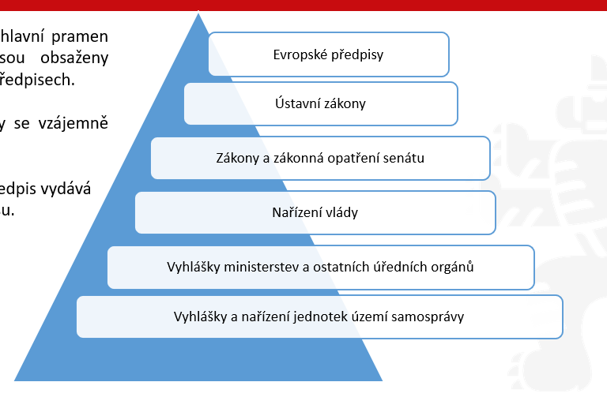

# 🏛️ Základy právních nauk

**Datum:** 13/09/25
**Témata:** Právo, pojem práva, dualismus, prameny práva a právní systémy, právní řád ČR, právní norma. Úvod do základů právních nauk.

---

### 🗺️ Mapa témat

```text
.
└── ZAKLADY_PRAVNICH_NAUK_P01/
    ├── 01_UVOD_A_HISTORIE_PRAVA/
    │   ├── Širší (morálka, zvyky) vs. užší (zákony) význam
    │   └── Historické kořeny (Chammurapi, Římské právo, přechod k psanému právu)
    │
    ├── 02_PRAVNI_SYSTEMY_SVETA/
    │   ├── Kontinentální evropské právo (psané, zákony, aplikace norem)
    │   ├── Angloamerické právo (soudní precedenty, dotváření práva)
    │   └── Islámské a tradiční systémy (náboženská pravidla, obyčeje)
    │
    ├── 03_DUALISMUS_PRAVA_STAVEBNI_KAMENY/
    │   ├── Přirozené vs. pozitivní (platné) právo
    │   ├── Objektivní (právní řád) vs. subjektivní (konkrétní oprávnění)
    │   ├── Hmotné (co smím/nesmím - zákoníky) vs. procesní (jak to řešit - řády)
    │   ├── Soukromé (rovnost, autonomie) vs. veřejné (nadřízenost státu)
    │   └── Relativní (inter partes) vs. absolutní (erga omnes)
    │
    ├── 04_PRAMENY_PRAVA_A_PRAVNI_RAD_CR/
    │   ├── Normativní právní akty (původní vs. odvozené)
    │   ├── Normativní smlouvy (kolektivní, mezinárodní)
    │   ├── Nálezy Ústavního soudu
    │   ├── Právní obyčeje a soudní precedenty
    │   └── Mezinárodní právo a Právo EU (primární, sekundární)
    │
    ├── 05_PRAVNI_NORMA/
    │   ├── Znaky (všeobecná závaznost, normativnost, vynutitelnost)
    │   ├── Struktura (Hypotéza, Dispozice, Sankce)
    │   └── Členění (Kogentní vs. Dispozitivní; přikazující, zakazující, opravňující, deklaratorní)
    │
    ├── 06_PUSOBNOST_A_PUBLIKACE/
    │   ├── Působnost (místní/prostorová, osobní, věcná, časová - platnost a účinnost)
    │   └── Publikace (Sbírka zákonů, Sbírka mezinárodních smluv)
    │
    └── 07_APLIKACE_A_ANALOGIE/
        ├── Postup aplikace (stanovit problém -> vymezit úpravu -> aplikovat normu)
        └── Analogie (podle zákona, podle práva)
```

---

## 📖 Základní pojmy

> ⚖️ **Právo**
> Právo je soubor pravidel chování, kterými se řídí společnost a jejichž dodržování je vynutitelné státní mocí.

> 🧱 **Právní norma**
> Základní jednotkou pravidla chování (stavební kámen práva). Jde o závazné pravidlo chování.

> 📚 **Zákon (Právní předpis)**
> Soubor mnoha právních norem svázaných do jednoho celku.

> 🗂️ **Normativní právní akt**
> Nadřazená škatulka pro všechny psané právní dokumenty vydané státem (spadá sem Ústava, zákony, nařízení vlády, vyhlášky měst).

> 🏷️ **Právní odvětví**
> Oblast práva zaměřená na konkrétní téma (občanské, trestní, pracovní...). Každé odvětví má svůj hlavní zákon (kodex).

---

## ⚖️ Význam práva

**1. Širší význam práva**
* **Původ práva:** vychází z dlouhodobých zvyků, tradic, morálky a společenských pravidel.
* **Charakteristika:** Jsou to pravidla, která dodržují, protože je považují za správná (mají pocit, že jsou závazná).
* **Vývoj:** Časem se ty nejdůležitější zvyky přesunou z širšího do užšího. 

**2. Užší význam práva**
* **Původ práva:** Zvyky a pravidla, která stát oficiálně uznal a sepsal.
* **Charakteristika:** Právní normy a předpisy.
* **Funkce:** Na jejich základě státní orgány rozhodují.

---

## 🏛️ 1. Historické kořeny práva

**Starověké právo**

📜 ***Chammurapiho zákoník:***
Byla to jedna z vůbec nejstarších písemných právních památek (starověká Babylonie, (1800–1700 př. n. l.)). Fungoval na slavném principu „oko za oko, zub za zub“ a silně v něm prospívalo náboženské uspořádání – společnost tehdy věřila, že právo a spravedlnost sesílají bohové.   

🏛️ **Římské právo (Zákon XII desek):**
*Základ moderních právních systémů*
Jak správně říkáš, bylo neuvěřitelně nadčasové. Římané se odtrhli od čistého náboženského diktátu a začali právo stavět na logice, racionálních principech a ochraně majetku či smluv. Zákon XII desek byla vůbec první významná písemná kodifikace římského práva vyrytá na dvanácti dřevěných deskách, aby ji každý viděl na fóru. Na Římského práva staví dnešní kontinentální právní systém (včetně našeho).

👑 **Justiniánův kodex (Codex Iustinianus):** 
Je základní sbírka římského práva, kterou nechal v 6. století sepsat byzantský císař Justinián I. Je součástí rozsáhlejší kodifikace známé jako Corpus iuris civilis.

> 💡 **Rozlišovalo mezi civilním právem a církevním právem.**
> **Římské právo také rozlišovalo mezi soukromým (ius privatum) a veřejným právem (ius publicum).**
> *Jak to chápat:* Toto základní rozdělení na vztahy mezi rovnými lidmi (soukromé) a vztahy, kde vystupuje stát z pozice moci (veřejné), používáme v právu dodnes.

---

## 🌍 2. Právní systém

**Základní rozdělení:**
Většina států na světě staví své právo na jednom ze tří hlavních typů právní kultury, případně na jejich kombinaci.

**Tři hlavní pilíře světa:**

1. 🇪🇺 **Kontinentální evropské právo** (psané zákony, kodexy – to, co máme v ČR).   
  * **Základ:** Stojí na recepci (převzetí) starověkého římského práva.   
  * **Pramen:** Hlavním pramenem je psaný právní předpis (zákon, kodex). Soudní rozhodnutí podpůrný pramen. 
  * **Role soudu:** Soudci u nás právo netvoří – jejich úkolem je existující právní normy pouze aplikovat (použít na konkrétní případ). 
  * Soudní řízení se řídí zákonem.

2. 🇬🇧🇺🇸 **Angloamerické právo** (soudní precedenty, zvyklosti v USA nebo Velké Británii). 
  * **Základ:** Stojí na „nalézání práva“ soudy (typicky Velká Británie, USA).   
  * **Pramen:** Hlavním pramenem je soudní precedent (rozhodnutí soudu v dosud neupraveném případu, které je závazné pro budoucí podobné soudy).   
  * **Role soudu:** Soudci právo neustále dotvářejí a jejich verdikty tvoří závazná pravidla pro budoucnost.  

3. 🕌 **Islámské právo** (šaría, náboženské základy na Blízkém východě). 
  * Je to neměnné boží právo platící v některých státech Blízkého a Středního východu a v Africe.   
  * Primárně upravuje osobní věci jako rodinné, dědické nebo darovací právo. Závazkové právo (obchodní vztahy) se v těchto zemích často řídí převzatým kontinentálním nebo angloamerickým právem. 

4. 🛖 **Systém tradičních a náboženských práv:**
  * Stojí na právních obyčejích a náboženských pravidlech.   
  * Často existuje paralelně vedle systémů, které v zemích (např. v Africe či Asii) zanechaly bývalé koloniální mocnosti. Dnes se uplatňuje hlavně v otázkách osobního statutu (např. v Indii, Izraeli nebo některých arabských zemích).

---

## ⚖️ 3. Dualismus práva – jeho různé podoby

### 3.1 Přirozené vs. pozitivní (platné) právo:
* **Přirozené právo:** Soubor principů vycházejících z přirozených práv člověka.
* **Pozitivní (platné) právo:** Soubor norem vydaných státem, jejichž dodržování je státem vynucováno.

### 3.2 Objektivní vs. subjektivní právo:
* **Objektivní právo:** Celý právní řád, tedy všechen ten balík platných zákonů v daném státě.
  * *Definice:* Souhrn nebo systém platných právních norem, jejichž plnění je vynutitelné státní mocí. Je totožné s právním řádem konkrétního státu.
  * *Právní řád konkrétního státu* = souhrn všech právních norem, které jsou v daném časovém období na území konkrétního státu platné (objektivní právo).

* **Subjektivní právo:** Tvoje konkrétní osobní oprávnění, které pro tebe z toho objektivního práva vyplývá (např. „mám právo reklamovat zboží“, „mám právo volit“).
  * *Definice:* Oprávnění jednotlivce vyplývající z právní normy (objektivního práva). Subjektivní právo je jinak řečeno zákonem garantovaná míra možného chování subjektu, adresáta právní normy (člověk, právnická osoba – obchodní společnost).
  * Subjektivní právo je to, co adresát právní normy (objektivního práva) může učinit (jak může jednat), neboť mu to objektivní právo dovoluje.

### 3.3 Hmotné vs. Procesní právo
Každé právní odvětví má své předpisy (zákony), které dělíme podle toho, **co upravují**:

**A. Hmotné právo (CO)**
* **Definice:** Určuje konkrétní pravidla chování, práva a povinnosti – říká, co smíš, co nesmíš, co komu patří a co je trestné.
* **Charakteristika:** Upravuje společenské vztahy po stránce věcné.
* **Mnemotechnické znamení:** Hmotné zákony mají téměř vždy v názvu slovo **„zákon“** nebo **„zákoník“**.
* **Příklady:** Občanský zákoník, Trestní zákoník, Zákoník práce.

**B. Procesní právo (JAK)**
* **Definice:** Určuje pravidla postupu a řízení – říká, jak postupovat před úřady a soudy při vyřizování věcí nebo při porušení hmotného práva.
* **Charakteristika:** Nastupuje ve chvíli, kdy se právo uplatňuje nebo vymáhá.
* **Mnemotechnické znamení:** V 90 % případů končí slovesem/podstatným jménem **„řád“**.
* **Příklady:** Občanský soudní řád, Trestní řád, Správní řád, Daňový řád.

### 3.4 Soukromé vs. Veřejné právo
Právo jako celek se dělí podle toho, **v jakém postavení jsou účastníci právního vztahu**:

**A. Soukromé právo**
* **Postavení stran:** Vztahy mezi **rovnocennými subjekty** (občan–občan, občan–firma, firma–firma). Stát zde může vystupovat také, ale nemá nadřazenou pozici.
* **Klíčové zásady:**
  * **Zásada rovnosti stran:** Nikdo není druhému nadřízený, obě strany mají stejná práva a povinnosti.
  * **Zásada autonomie vůle (smluvní volnost):** „Občan může jednat tak, jak mu zákon nezakazuje, a není povinen činit to, co mu zákon neukládá.“ *(Co není zakázáno, je dovoleno)*.
* **Hlavní odvětví:** Občanské, obchodní, pracovní právo.

**B. Veřejné právo**
* **Postavení stran:** Vztahy, kde je **stát v nadřízené (svrchované) pozici** vůči občanovi nebo firmě.
* **Klíčové zásady:**
  * **Chránění veřejného zájmu:** Stát určuje pravidla pro fungování společnosti.
  * **Vázanost zákonem:** Státní orgány mohou jednat **pouze v mezích a způsoby, které stanoví zákon** *(Stát smí jen to, co má výslovně povoleno)*.
* **Hlavní odvětví:** Správní, trestní, finanční, ústavní právo.

#### 📊 Přehled právních odvětví a jejich zákonů

**A. Soukromé právo (Rovnocenné postavení)**

| Právní odvětví | Hmotné právo (CO) | Procesní právo (JAK) |
| :--- | :--- | :--- |
| **Občanské právo** | **Občanský zákoník** | **Občanský soudní řád** *(společný)* |
| **Obchodní právo** | **Zákon o obchodních korporacích** | **Zákon o zvláštních řízeních soudních** |
| **Pracovní právo** | **Zákoník práce** | *(pro soukromé právo obecně)* |

**B. Veřejné právo (Nadřazenost státu)**

| Právní odvětví | Hmotné právo (CO) | Procesní právo (JAK) |
| :--- | :--- | :--- |
| **Správní právo** | **Stavební zákon** *(a mnohé další)* | **Správní řád** |
| **Trestní právo** | **Trestní zákoník** | **Trestní řád** |
| **Finanční právo** | **Zákon o daních z příjmů** | **Daňový řád** |

### 3.5 Relativní x Absolutní
Rozdíl je v tom, vůči komu právo platí (kdo má vůči tobě povinnost):

**Relativní právo (jen vůči konkrétní osobě – inter partes)**
* **Definice:** Právo, které platí jen mezi konkrétně určenými lidmi.   
* **Princip:** Máš právo něco požadovat jen po jedné konkrétní osobě.   
* **Příklad:** Půjčíš Petrovi 1 000 Kč. Právo na vrácení peněz máš jen vůči Petrovi (nemůžeš požadovat vrácení po jeho sousedovi ani po náhodném kolemjdoucím).
* *Mnemotechnika:* **Relativní** = Relativně úzký okruh lidí (jen ten, s kým máš smlouvu/dohodu).

**Absolutní právo (vůči všem na světě – erga omnes)**
* **Definice:** Právo, které musí respektovat všichni ostatní lidé bez výjimky.   
* **Princip:** Všichni ostatní mají povinnost ti do tvého práva nezasahovat a nekazit ti ho.   
* **Příklad:** Vlastnictví telefonu nebo tvé právo na život. Všichni lidé na světě mají povinnost ti tvůj telefon nekrást a nekovat na něj nárok.
* *Mnemotechnika:* **Absolutní** = Absolutně všichni na světě.

---

## 🏛️ Systém práva

Uspořádání všech právních norem do jednoho logického celku. Dělí se podle dvou hlavních hledisek:

**1. Podle právní síly (hierarchie):**
* Ústava a ústavní zákony (nejvyšší síla)
* Běžné zákony (přijaté parlamentem)
* Podzákonné předpisy (vyhlášky ministerstev, nařízení vlády, městské vyhlášky)

**2. Podle odvětví:**
* Soukromé: občanské, obchodní, pracovní právo.
* Veřejné: trestní, správní, finanční právo.

---

## 📚 4. Prameny práva, právní normy, právní řád

* **Co je pramenem práva:** 
  **Pramen práva =** oficiální základ, který dává právnímu pravidlu jeho závaznost a autoritu (důvod, proč má stát právo jeho dodržování vymáhat).
  Je to forma objektivního práva, která v sobě obsahuje právní normy. Tyto formy se liší podle toho, v jakém právním systému a kultuře se nacházíme.   
  Každý stát má svou vlastní a unikátní kombinaci pramenů práva.   

**4 hlavní historicky zformované typy pramenů práva:**

1. 📄 **Normativní právní akty** (např. zákony, nařízení) – to je to naše hlavní psané právo.   
2. ⚖️ **Soudní rozhodnutí, precedenty** – rozhodnutí soudů, která vytvářejí závazná pravidla pro budoucí případy (typické pro angloamerický systém).   
3. 📜 **Právní obyčeje** – historicky vůbec nejstarší pramen práva založený na dlouhodobých tradicích. 
   Je to nepsaná tradice, která má ale plnou sílu a vymahatelnost zákona.
4. 🤝 **Normativní smlouvy** – mezinárodní nebo kolektivní smlouvy, které regulují určitou skupinu případů.

### 📄 Normativní právní akty

* **Co to je:** Jde o obecně závazné právní předpisy, tedy soubory právních norem vydané orgánem veřejné moci v náležité formě.
  * **Hlavní vlastnosti:** 
    * Jsou typickým pramenem pro kontinentální evropský právní systém. 
    * Vznikají právotvornou činností státních orgánů, které mají pravomoc právní normy vydávat, měnit nebo rušit. 
    * Aby byl normativní právní akt platný, musí být předepsaným způsobem oficiálně vyhlášen.
  * **Absolutně závazné prameny v ČR:** Do této hlavní kategorie patří společně s normativními smlouvami (včetně mezinárodních) a nálezy Ústavního soudu. 

**Původní (primární) normativní právní akty**
* **Nejvyšší právní síla:** Primární předpisy stojí na vrcholu právního systému.
* **Čtyři hlavní typy původních aktů:**
  1. **Ústava a ústavní zákony:** Jde o úplně nejvyšší zákony státu, které přijímá parlament ČR oběma komorami.
  2. **Zákony:** Standardní primární předpisy, které přijímá Poslanecká sněmovna (určité schvalovací funkce má i Senát a prezident republiky).
  3. **Zákonná opatření Senátu:** Vydává je Senát v situaci, kdy Poslanecká sněmovna nemůže vykonávat své pravomoci.
  4. **Obecně závazné vyhlášky:** Vydávají je obecní a městská zastupitelstva nebo kraje pro své území.

**Odvozené (sekundární) normativní právní akty**
* **Kdo je vydává:** Jde o akty výkonných orgánů a orgánů státní správy.
* **Právní síla:** Mají nižší právní sílu než zákony.
* **Zásada podřízenosti:** Nesmí v žádném případě odporovat normativním právním aktům, od nichž jsou odvozeny.
* **K čemu slouží:** Slouží k podrobnější právní úpravě věcí, které už jsou v zásadě upraveny primárními normativními akty (zákony).

**Příklady odvozených právních aktů**
* **Vládní nařízení:** Vláda ČR je Ústavou generálně zmocněna k tomu, aby vydávala prováděcí nařízení k zákonům.
* **Vyhlášky ministerstev a ústředních orgánů státní správy:** Tyto předpisy lze vydávat výhradně na základě výslovného zmocnění v konkrétním zákoně.
* **Vyhlášky a předpisy ČNB:** Vydává je Česká národní banka rovněž na základě zákonného zmocnění.
* **Nařízení obcí a krajů:** Jedná se o normativní právní akty vydávané v tzv. přenesené působnosti.

**Znaky normativních právních aktů**
* **Forma:** Normativní právní akt je výsledkem záměrné činnosti orgánu veřejné moci, který k tomu má legislativní pravomoc. Vzniká předepsanou legislativní procedurou a musí být řádně publikován, jinak se nemůže stát platným a účinným.
* **Normativita:** Znamená to, že daný předpis obsahuje obecná pravidla chování.
* **Abstraktnost:** Pravidla mají obecný charakter. Nejsou napsaná pro konkrétního člověka jménem, ale dopadají na každého, kdo se ocitne v typově určené situaci.
* **Obecná závaznost:** Předpis zavazuje všechny osoby, které se nacházejí v působnosti orgánu, jenž daný normativní právní akt vydal.

### 🤝 Normativní smlouvy
* **Co je smlouva:** Jedná se o dvoustranné či vícestranné právní jednání.
* **Kdy se stává pramenem práva:** Smlouva získá tzv. normativní význam a stane se pramenem práva teprve v okamžiku, kdy reguluje určitou skupinu případů stejného druhu.
* **Dva hlavní typy normativních smluv jako pramenů práva v ČR:**
  1. **Kolektivní smlouvy** uzavřené mezi zaměstnavateli a odbory na vnitrostátní úrovni.
  2. **Mezinárodní smlouvy**, pokud jsou řádně "převzaty" do našeho vnitrostátního práva.

### 🏛️ Nálezy Ústavního soudu
* **Ochránce ústavnosti:** Ústavní soud ČR je nejvyšším orgánem, který má roli "ochránce ústavnosti".
* **Dotváření práva:** Formou svých nálezů dotváří již existující formální soustavu pramenů práva v ČR (tedy normativní právní akty a normativní smlouvy).
* **Zrušení zákona:** Pokud Ústavní soud v řízení zjistí, že nějaký zákon nebo jeho část je v rozporu s ústavním zákonem, rozhodne nálezem a takový předpis (nebo jeho ustanovení) ke dni stanovenému v nálezu zruší.

### 🇬🇧 Prameny práva (angloamerický systém) 

**Právní obyčej**
* **Historický původ:** Patří k historicky nejstarším pramenům práva, v České republice se však uplatňuje pouze výjimečně (například v podobě obchodních zvyklostí).
* **Zvykové právo:** Jde o systém založený na právních obyčejích, které se v určitém společenství dlouhodobě ustálily a jsou všeobecně uznávány a dodržovány.
* **Podmínka pro uznání za pramen práva:** Aby byl obyčej brán jako pramen práva, musí ho stát oficiálně uznat, státní orgány ho musí aplikovat na konkrétní případy a v případě jeho porušení musí následovat státní sankce.

**Soudní precedent**
* **Co to je:** Jde o rozhodnutí soudu nebo jiného státního orgánu, kterým se řeší situace, jež nebyla právem dosud regulována – tedy se jedná o vůbec první řešení daného případu, který dosud nebyl právem upraven.   
* **Právní závaznost pro budoucnost:** Podstatou precedentu je skutečnost, že toto vůbec první posouzení případu se do budoucna stává právně závazným pro všechny další případy stejného druhu.   
* **Kde se vyskytuje:** Tento pramen práva je nejcharakterističtější pro angloamerický systém nebo mezinárodní právo. 

---

## 🧱 5. Právní normy

* **Základní jednotka:** Právní norma je základní a nejmenší jednotkou právního normativního aktu.
* **Pravidlo chování:** Jde o závazné pravidlo chování, které se vyznačuje třemi klíčovými znaky:
  1. **Všeobecnou závazností:** Platí pro všechny subjekty, na které dopadá.
  2. **Normativností:** Chování je v ní nastaveno v podobě obecného a abstraktního pravidla (neřeší konkrétní jeden případ jmenovitě).
  3. **Vynutitelností státní mocí:** Pokud někdo normu poruší, stát je schopen a oprávněn vynutit nápravu nebo uložit sankci.
  4. **Formální určitost:** Musí být zapsána v oficiálním prameni práva (např. ve Sbírce zákonů).

### 🎯 Mody normativnosti

Způsob, jakým právní norma reguluje lidské chování (jaký má na nás požadavek). Rozdělujeme je do dvou rovin:
Jaký je to mód rozdíl vůči do jaké kategorie patří


**1. Objektivní mody (z pohledu samotného zákona):**
* **a) Příkaz:** Zákon přikazuje něco aktivně udělat *(musíš)*.
* **b) Zákaz:** Zákon zakazuje určité chování *(nesmíš)*.
* **c) Dovolení:** Zákon dává na výběr, je to možnost *(můžeš)*.

**2. Subjektivní mody (z pohledu konkrétního človeka/adresáta):**
* **a) Oprávnění:** Máš právo něco udělat nebo požadovat, pokud sám chceš.
* **b) Povinnost:** Musíš něco udělat nebo naopak něco nedělat, ať už chceš, nebo ne.

### Kogentní a dispozitivní právní normy
* 🛑 **Kogentní právní norma:**
  * Je to taková právní norma, u níž není možné se odchýlit.
  * Strany si nemohou sjednat nic jiného, než co norma přikazuje.
  * Je typická zejména pro právo veřejné.
  * Zahrnuje obecný příkaz, zákaz nebo dovolení a dělí se na přikazující, zakazující a opravňující.

* 🤝 **Dispozitivní právní norma:**
  * Je to taková právní norma, u které se lze odchýlit od pravidla chování obsaženého v dispozici normy.
  * Pokud si strany víceméně sjednají pravidla po svém, má přednost jejich ujednání; pravidlo ze zákona nastupuje až tehdy, kdy si strany vlastní postup nezvolí.
  * Je typická pro právo soukromé (např. v občanském právu a smluvních vztazích).

### Struktura právní normy
* ❓ **Hypotéza:**
  * Vyjadřuje podmínky, za kterých se má realizovat vlastní pravidlo chování.
  * Vymezuje okruh adresátů normy, čas a působnost.
* ➡️ **Dispozice:**
  * Upravuje vlastní pravidlo chování.
  * Subjektům něco přikazuje, zakazuje nebo je opravňuje k nějakému jednání.
  * Nastupuje za předpokladu, že nastaly okolnosti stanovené v hypotéze.
* ⚠️ **Sankce:**
  * Je předem stanovený následek za to, že nebyla dodržena dispozice právní normy.
  * Nemusí představovat pouze trest, ale může jí být například povinnost nahradit škodu.
  * Může plnit několik funkcí, mezi které patří preventivní, nahrazovací a represivní.

  ### 📐 Logická struktura právní normy

  Tradičně se vychází z toho, že struktura právní normy je **trichotomická (trojčlenná)** a má logickou podobu podmíněné věty (implikace):

  > **„Jestliže je $p$ (hypotéza), pak nastává $q$ (dispozice), není-li $q$, nastupuje $r$ (sankce).“**

  Tato logická podoba přímo vyplývá z jejího charakteru jako pravidla chování:
  * **$p$ (Hypotéza):** Nastaly podmínky/situace? *(Jestliže...)*
  * **$q$ (Dispozice):** Jak se máš chovat? *(Pak...)*
  * **$r$ (Sankce):** Co se stane, když se tak nezchováš? *(Není-li $q$, pak nastupuje...)*
  * Není-li $q$: Nedošlo k žádoucímu chování = porušil jsi dispozici / pravidlo.

**Příklad struktury právní normy**
* **Rozptýlení v právním řádu:** V reálném právním řádu najdeme všechny tři části v jediném ustanovení pouze výjimečně, velmi často bývají rozptýleny v rámci určitého právního předpisu.
* **Příklad hypotézy:** „kdo najde ztracenou věc“ – vymezuje podmínku a situaci, na kterou se norma vztahuje (§ 135 OZ).
* **Příklad dispozice:** „je povinen ji vydat vlastníkovi“ – stanoví pravidlo chování pro danou situaci (§ 135 OZ).
* **Příklady sankce:** Náhrada újmy, úroky z prodlení (v případě prodlení s plněním dluhu a podobně).

### 🏷️ Klasifikace (členění) právních norem

Právní normy dělíme podle dvou hlavních kritérií:

#### 1. Podle stupně závaznosti:
* 🛑 **Kogentní (kategorické):** Formulovány imperativně, nedávají žádný prostor pro vůli adresáta (musí se přesně splnit). Typické pro **veřejné a procesní právo**.
* 🤝 **Dispozitivní:** Pravidlo ze zákona nastupuje až tehdy, pokud si strany ve smlouvě nedohodly vlastní postup (dává prostor pro dohodu). Typické pro **soukromé právo**.

#### 2. Podle způsobu vymezení pravidla chování:
* **Přikazující:** Určují, jak se chovat (ukládají povinnost něco udělat, např. nosit helmu).
* **Zakazující:** Zakazují určitý druh chování (ukládají povinnost zdržet se jednání, např. zákaz předjíždění).
* **Opravňující:** Dovolují určitý druh chování (dávají možnost/oprávnění, např. právo na ochranu osobnosti).
* **Deklaratorní:** Vyjadřují obecné principy, cíl nebo definice (nemají klasický příkaz ani zákaz).
---

## 🎯 6. Působnost právních norem

Při používání právních předpisů je třeba vždy vyhodnotit:
- Územní obvod, na kterém norma působí.
- Okruh vztahů, na které se norma vztahuje.
- Okruh subjektů, kterých se norma týká.
- Platnost a účinnost právního předpisu.

**Typy působnosti:**
- 🗺️ **Místní (prostorová):** vymezuje území, na kterém předpis platí. Rozlišujeme: a) celostátní (zákony), b) omezenou (vyhlášky obce).
- 👥 **Osobní:** Na koho se vztahuje.
- 💼 **Věcná:** Jakých konkrétních případů se norma týká.
- ⏱️ **Časová (Platnost x účinnost):** *Platnost* = vyšlo ve Sbírce, už to existuje. *Účinnost* = odkdy se tím musím reálně řídit.

### 📁 Věcná působnost

* **Definice:** Týká se skutkové charakteristiky případů, které právní norma upravuje. Souhrn norem upravujících určitý konkrétní věcný okruh se nazývá **právní institut** (např. institut manželství, institut vlastnictví).

* **Rozdělení norem podle věcné působnosti:**
  * **Normy obecné (*lex generalis*):** Mají obecnou působnost a vztahují se na větší počet stejných případů (např. Občanský zákoník obecně).
  * **Normy speciální (*lex specialis*):** Mají zvláštní působnost a upravují odlišně věcně shodnou problematiku pro konkrétnější situace (např. Zákonik práce vůči Občanskému zákoníku).

> 💡 **Zkoušková zásada:** Speciální norma má vždy přednost před normou obecnou (*Lex specialis derogat legi generali*).

### 🗺️ Prostorová (místní) působnost

* **Principy:** Vychází z teritoriální působnosti orgánů veřejné moci, které příslušné právní normy vydávají nebo oficiálně uznávají.

* **Členění norem podle územní platnosti:**
  * **Právní normy s celostátní působností:** Platí na celém území státu (např. zákon).
  * **Lokální (místní) právní normy:** Platí pouze na konkrétním vymezeném území (např. nařízení rady kraje nebo obecně závazná vyhláška obce).

* **Exteritorialita:** Použití právní normy mimo území státu, jehož právního řádu je součástí (např. působnost zákonů na zastupitelských úřadech/ambasádách v zahraničí nebo na palubách námořních lodí a letadel).

### 👤 Osobní působnost

* **Principy:** Je založena na principu **rovnosti před zákonem**. Určuje, na **které osoby** (právní subjekty) norma platí.
* **Vymezení v zákoně:** Spočívá v druhovém vymezení právních subjektů v hypotéze normy (např. formulace typu *„každý“*, *„občan ČR“*, *„řidič“*, *„zaměstnanec“*).
* **Výjimky (Imunita a exempce):** Součástí je možnost stanovit **imunitu** a **exempce** (vynětí z působnosti zákona) a vymezit jejich rozsah pro určité skupiny subjektů (např. diplomati, poslanci, senátoři, prezident).

#### 🛡️ Druhy imunity (vynětí z osobní působnosti)

* **Absolutní imunita (indemnita):** Nelze ji v žádném případě odejmout ani prolomit.
  * **Hlava státu (prezident/monarcha):** V ČR není prezident v době funkčního období odpovědný za přestupky ani trestné činy (může být souzen pouze za velezradu před Ústavním soudem).
  * **Diplomatičtí zástupci:** Nelze je v daném státě trestat; hostitelský stát je může pouze prohlásit za nežádoucí osobu (*persona non grata*) a vyhostit.
  * **Členové zákonodárného sboru (poslanci a senátoři):** Platí absolutně pro jejich **hlasování** ve Sněmovně, Senátu nebo jejich orgánech (za hlasování nemohou být nikdy postiženi).

* **Relativní imunita:** Lze ji za stanovených podmínek odejmout (je prolomitelná souhlasem).
  * **Členové zákonodárného sboru (poslanci a senátoři):** Trestní stíhání nebo postih za projevy je podmíněn souhlasem příslušné komory (Poslanecké sněmovny nebo Senátu).
  * **Soudci Ústavního soudu:** Mají obdobný rozsah imunity a režim trestní či přestupkové odpovědnosti jako členové zákonodárného sboru.

> 💡 **Jak funguje relativní imunita v praxi (vydání poslance či senátora):**
> 
> * **Sněmovna VYDÁ (dá souhlas):** Trestní stíhání a soudní řízení probíhá **ihned** (i během trvání mandátu).
> * **Sněmovna NEVYDÁ (nedá souhlas):** Trestní stíhání se po dobu mandátu **přerušuje** a soudní řízení začne až **po skončení mandátu** *(promlčecí doba po tuto dobu neběží)*.

### ⏱️ Časová působnost

Časová působnost určuje časový úsek, v němž právní norma platí a vyvolává právní následky. Klíčové je rozlišovat mezi platností a účinností:

* **Platnost:**
  * Nastává dnem publikace/vyhlášení ve Sbírce zákonů.
  * Norma se stává součástí právního řádu a je možné se s jejím obsahem seznámit.
  * **Pravidlo ještě není závazné** (nelze podle něj ještě vymáhat povinnosti).

* **Účinnost:**
  * Nastává dnem uvedeným v závěrečném ustanovení daného předpisu.
  * Pokud datum není v zákoně uvedeno, účinnost nastává **15. dnem po zveřejnění** ve Sbírce zákonů.
  * Od tohoto okamžiku je norma plně **závazná a vynutitelná**.

* **Splynutí platnosti a účinnosti:**
  * Ve výjimečných a naléhavých případech mohou platnost a účinnost nastat v ten samý den (dnem publikace).

> 💡 **Zkouškový pojem – Legisvakanční lhůta (*vacatio legis*):**
> Je to časový interval mezi dnem **platnosti** a dnem **účinnosti**. Slouží k tomu, aby se veřejnost i úřady stihly s novým zákonem seznámit a připravit se na něj.

---

## 🇨🇿 Právní řád České republiky

- **Souhrn všech platných a účinných pramenů práva na území daného státu.**
- Je tvořen všemi právními předpisy ČR a v nich obsaženými právními normami.
- Nejdůležitějšími právními předpisy jsou zákony (soubory pravidel chování upravující základní oblasti života).
- Právní normy jako základní a hlavní pramen práva v ČR jsou obsaženy v obecně závazných právních předpisech.

**Obecně závazné předpisy se vzájemně odlišují podle:**
- Stupně právní síly.
- Orgánu, který právní předpis vydává.
- Formy právního předpisu.



---

## 🌐 Mezinárodní právo a Právo EU v ČR

- **Mezinárodní právo veřejné:** reguluje mezinárodní vztahy mezi veřejnými subjekty (státy a mezinárodní organizace).
- **Mezinárodní právo soukromé:** reguluje mezinárodní vztahy mezi soukromými osobami.
- **Právo EU:** Evropská unie má rámcová pravidla pro jednotlivé typy společenských vztahů. Povinností všech členských států je sladit svůj právní řád s normami EU. Důvodem je průchodnost vztahů mezi subjekty za relativně stejných právních podmínek (Primární a sekundární právo).

---

## 📢 Publikace pramenů práva

Dva publikační způsoby v České republice:

1. 📘 **Sbírka zákonů (Sb.)**
   - Publikují se zákony, nálezy Ústavního soudu, rozsudky Nejvyššího správního soudu, sdělení Ústavního soudu atd.
   - Podmínkou platnosti a účinnosti převážné většiny obecně závazných právních předpisů (s výjimkou předpisů územní samosprávy) je jejich publikování ve Sbírce zákonů.


### 📰 Publikace & Sbírka zákonů
* **Co se vyhlašuje:** Ústavní zákony, zákony, zákonná opatření Senátu, nařízení vlády, vyhlášky ministerstev.
* **Fungování Sbírky:** Číslované částky dle roků (nelze přečíslovat), elektronická i tištěná verze.
* **Struktura předpisu:** Paragraf (§) → Odstavec → Písmeno.
* **Vyhlášení:** Datum rozeslání částky Sbírky.
* **Vzorec citace:** `č. [číslo]/[rok] Sb., [název]` (např. *č. 89/2012 Sb., občanský zákoník*).
* **Klíčové pojmy:**
  * **Novela** = předpis měnící jiný zákon.
  * **Novelizace** = proces úpravy zákona.
  * **Úplné znění** = vyhlášený zákon se všemi změnami dohromady.

2. 📗 **Sbírka mezinárodních smluv (Sb.m.s.)**
   - Vyhlašují se sdělením Ministerstva zahraničních věcí: platné mezinárodní smlouvy, oznámení a výpovědi mezinárodních smluv, rozhodnutí přijatá mezinárodními orgány, jimiž je ČR vázána.

---

## 🔎 7. Aplikace a interpretace právních norem

**Aplikace práva:** Používání právní normy státními orgány i chování fyzických a právnických osob podle práva.

**Postup:**
1. Zjištění skutkového stavu (stanovit problém).
2. Zjištění právních norem (vymezit právní úpravu).
3. Rozhodnutí ve věci samé (Aplikovat právní normu a stanovit řešení).

*Logika procesu:* Skutkový stav ➔ Právní norma ➔ Rozhodnutí.

**Analogie v právu:**

> **Analogie =** Řešení mezer v právu. Použití podobného pravidla na případ, který zákon výslovně neupravuje. Státní orgán (zpravidla soud) **nesmí odmítnout rozhodnout** věc pro nedostatek úpravy.
> * **Připuštěna:** v soukromém právu (občanské, obchodní, rodinné, pracovní).
> * **Vyloučena:** ve veřejném právu (trestní, finanční, správní).

- **Analogie podle zákona:** použití norem, která upravuje nejobdobnější případ.
- **Analogie podle práva:** pokud nejsou ani obdobné právní normy, situace se řeší podle obecných právních zásad.

