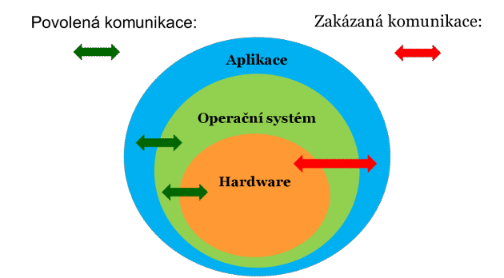

## 1. Úvod do operačních systémů

### Definice operačního systému
Operační systém (OS) je **souhrn všech systémových programů**, které tvoří základní programové vybavení počítače [1]:
- Obsluhuje veškeré technické prostředky (hardware) počítače [1].
- Poskytuje systémové služby aplikačním programům [1].
- Spouští se obvykle automaticky po zapnutí počítače [1].
- S výjimkou uživatelského rozhraní je pro uživatele neviditelný [1].
- **Nejčastější zástupci:** OS řady MS Windows, Linux [1].

**Průběh spuštění:** Po zapnutí počítače se nejprve zavede a spustí operační systém. Až po dokončení jeho inicializace je možné spouštět aplikační programy [2].¨

---

## 2. Třívrstvá architektura a její výhody

Strukturu počítačového systému tvoří tři hlavní vrstvy: **Aplikace → Operační systém → Hardware** [2].

* **Povolena je pouze komunikace:** Aplikace ↔ Operační systém a Operační systém ↔ Hardware [2].
* **Zakázána je přímá komunikace:** Aplikace ↔ Hardware [2].

### Výhody třívrstvé architektury
1. **Aplikace se nemusí starat o detaily hardwaru:** Existuje mnoho různých modelů HW od různých výrobců, z nichž každý vyžaduje specifický způsob komunikace [2].
2. **Jednodušší komunikace s hardwarem:** Společné funkce (a uživatelské rozhraní) se řeší centrálně na úrovni OS, nikoliv v každé aplikaci zvlášť, což výrazně ulehčuje práci programátorům [2, 3].
3. **Spravedlivé dělení HW zdrojů:** Při běhu více programů současně dohlíží OS jako „šéf“ na přidělování procesoru, paměti a dalších zdrojů, protože dobrovolné střídání aplikací v praxi nefunguje [3].

---

## 3. Hlavní úkoly a služby operačního systému

Hlavním cílem OS je zajistit uživateli možnost ovládat počítač, vytvořit pro spuštěné programy stabilní aplikační rozhraní a přidělovat jim systémové zdroje [3].

* **Ovládání počítače:** Umožňuje uživateli spouštět programy, předávat jim vstupní data, zobrazovat výstupy a poskytuje uživatelské rozhraní [4].
* **Abstrakce hardwaru:** Vytváří aplikační rozhraní (API) pro programy a pro přímé ovládání technického vybavení využívá ovladače zařízení [4].
* **Správa prostředků (zdrojů):** Přiděluje spuštěným programům systémové prostředky (operační paměť, procesor, pevný disk, I/O zařízení) [4, 5].
* **Bezpečnost:** Zajišťuje nastavení a kontrolu přístupových práv uživatelů (definuje, kdo smí s čím pracovat a jak) [5].
* **Co je důležité:** 

Aplikace = Zákazník: Řekne číšníkovi z menu: „Chci čaj.“ (Volá API). Zákazník neřeší, jaký model rychlovarné konvice restaurace používá.   OS = Vrchní číšník / Šéfkuchař: Přijme objednávku „Chci čaj“ a ví, na které pracoviště ji má poslat.Ovladač (Driver) = Kuchař u konkrétního stroje: Dostane od šéfkuchaře pokyn „Uvař vodu“ a ví přesně, která tlačítka a páčky zmáčknout na konkrétním kávovaru nebo konvici (Hardware), aby voda začala vřít.

$$\text{Aplikace} \xrightarrow{\quad \text{volá API (vytvořené OS)} \quad} \text{Operační systém} \xrightarrow{\quad \text{volá rozhraní ovladače} \quad} \text{Ovladač (od výrobce HW)} \xrightarrow{\quad \text{řídí} \quad} \text{Hardware}$$

---

## 4. Řady (třídy) operačních systémů a platformy

Operační systémy se liší ve způsobu realizace poskytovaných služeb a rozhraní [5].

### Přehled nejběžnějších OS
* **Osobní počítače (PC):**
  * **Microsoft Windows:** Windows 95, 98, NT, 2000, XP, Vista, Windows 7, Windows 10, Windows 11... [5]
  * **Linux:** Různé distribuce (Ubuntu, SuSE, Debian, Mandrake, Fedora, Red Hat, Gentoo...) [6].
  * **Macintosh (Apple):** System, Mac OS / macOS [6].
* **Mobilní telefony:** Android, iOS (Apple), Windows Phone (Microsoft) [6].

### Systémová platforma
Platformou se rozumí soustava komponentů tvořící počítač (HW + OS) [13].
* **Dle typu HW:**
  * **x86:** 32bitové procesory (Intel, AMD) [13].
  * **x86-64 (AMD64):** 64bitové procesory (Intel, AMD) [14].
  * **Macintosh:** Počítače firmy Apple [14].
* **Dle typu OS:** Platformy MS Windows (32/64 bit), Linux, Mac OS [14].

### Přenositelnost aplikací
Aplikace obecně **nejsou přenositelné** mezi různými operačními systémy z důvodu rozdílných formátů spustitelných souborů (Windows: `.exe`, Linux: formát ELF bez přípony) a odlišných pravidel komunikace přes API (např. WinAPI) [14, 15].

**Řešení přenositelnosti (Jazyk Java):**
Java vytváří mezivrstvu – virtuální stroj **JVM (Java Virtual Machine)** [15]. Programy se nejprve přeloží do univerzálního kódu (**Byte Code** - `.class`), který je následně spouštěn v prostředí JVM daného operačního systému [15].

---

## 5. Typy rozhraní a ovladače

Rozhraní lze rozdělit podle komunikačních vrstev na [6, 7]:
1. **Uživatelské rozhraní** (Uživatel ↔ Aplikace / OS) [7]
2. **Aplikační rozhraní - API** (Aplikace ↔ OS) [7]
3. **Ovladače zařízení** (OS ↔ Hardware) [7]
4. **Správa systémových prostředků** [7]

### Uživatelské rozhraní (UI)
* **Příkazový řádek (CLI / Console):** Textové příkazy zadávané klávesnicí, výsledky zobrazeny jako text [9].
* **Grafické uživatelské rozhraní (GUI):** Kombinace textu a grafiky, ovládání myší, klávesnicí či dotykovým displejem [9].
* **Správa obrazovky:** Sdílení obrazovky pomocí oken. OS zajišťuje správné zobrazení, překreslování, překrývání oken, jejich velikost, pozici a ovládací prvky (tlačítka zavření/minimalizace, posuvníky, pás karet) [7, 8].

### Ovladače zařízení (Device Drivers) a Firmware
Ovladač zařízení je software umožňující operačnímu systému pracovat s hardwarem [8].
* Zajišťuje řízení konkrétního zařízení a s OS komunikuje přes obecnější rozhraní (abstrakce zařízení) [9].
* Umožňuje používat stejné nebo podobné rozhraní pro podobná zařízení (např. jednotný přístup k HDD, CD/DVD či flash disku) [9].
* **Typy:**
  * **Ovladač (Driver):** Ovládací program instalovaný do OS, stává se jeho součástí [9, 10].
  * **Firmware:** Ovládací program uložený přímo v paměti ROM daného zařízení, spouští se přímo ze zařízení [10].

### Aplikační rozhraní (API) a knihovny
API (Application Programming Interface) tvoří sbírku funkcí a procedur pro programátory [10]. Abstrahuje ovládání HW tak, že programátor volá stejné funkce bez ohledu na konkrétní médium nebo budoucí HW rozhraní [10, 11].

* **Statická knihovna (SLL - Static Linking Library):**
  * Připojuje se přímo do výsledného spustitelného souboru při překladu [11, 12].
  * Výsledný `.exe` soubor obsahuje vše potřebné ke svému běhu [12].
  * Typické přípony: `.lib`, `.a` [12].
* **Dynamická knihovna (DLL - Dynamic Linking Library):**
  * Nepřidává se do spustitelného souboru; při překladu se vytvoří pouze odkaz v tabulce symbolů [12].
  * Knihovna musí být k dispozici jako samostatný soubor při běhu programu [12].
  * Typické přípony: `.dll` (Windows), `.so` / `.o` (Linux) [12].

---

## 6. Správa procesoru

Většina osobních počítačů má jeden či více procesorů / jader [15, 16]. Úkolem správy procesoru je zajistit souběžný běh více programů – **multitasking** [16].

### Multitasking a sdílení času
Programy se střídají v běhu po uplynutí velmi krátkého časového úseku (ms), což vytváří iluzi současného běhu [16].
* **Kooperativní multitasking:** Procesy musely samy aktivně nabízet přerušení své činnosti (např. Windows 3.x) [16].
* **Preemptivní multitasking:** OS násilně přeruší proces vždy, když nastane definovaná událost (např. uplynutí časového kvanta) [17]. Dnešní standard (Windows 95+, Linux) [17].

### Paralelismus a multithreading
* **Vícejádrové / víceprocesorové systémy:** Umožňují reálně paralelní (souběžné) zpracování procesů na více jádrech [17, 18].
* **Multithreading:** Rozdělení jednoho procesu na několik samostatných vláken (**Threads**), která mohou běžet současně [17, 18].
* **Nástroje pro sledování:** Správce úloh ve Windows (`CTRL+ALT+DEL`), příkaz `ps` v Linuxu [19].

---

## 7. Správa paměti

Paměť je skládaná z paměťových míst (obvykle o velikosti 1 Byte), z nichž každé má své pořadové číslo – **adresu** [20].

### Funkce správce paměti
1. Udržuje informace o využití fyzické paměti (RAM) [18, 19].
2. Přiděluje a odebírá paměť procesům [18, 19].
3. Vrací uvolněnou paměť zpět do fondu volné paměti [18, 19].
4. Ošetřuje případy, kdy proces skončí havárií bez uvolnění paměti [19].
5. **Zajišťuje ochranu paměti:** Nedovolí procesům přistupovat mimo jim vymezený paměťový prostor [19].

### Virtuální paměť
* Každému procesu je přidělena jeho vlastní **virtuální paměť**, která bývá násobně větší než fyzická RAM [19, 20].
* Virtuální paměť je rozdělena na **stránky** (např. 4 kB) [19].
* Fyzická paměť je rozdělena na **rámy** stejné velikosti [19].
* OS mapuje stránky virtuální paměti na rámy ve fyzické paměti, případně nepoužívané stránky odkládá na pevný disk (paging/swapping) [20].

---

## 8. Správa souborů a systémy souborů

Správa souborů zajišťuje ukládání a čtení dat na paměťových médiích, vytváří datovou abstrakci ve formě souborů a hierarchické adresářové struktury [20, 21].

### Systém souborů (File System)
Systém souborů určuje normu pro ukládání dat a metadat na disk [21, 22]:
* Eviduje volné místo na disku [22].
* Určuje způsob uložení dat souboru (rozdělení do bloků / „přihrádek“) [21, 22].
* Ukládá **metadata** souboru (jméno, časové údaje, atributy, přístupová práva) [22].
* Udržuje adresářovou strukturu [22].

### Vlastnosti a rozdíly systémů souborů
* **Výkon:** Rychlost výpisu adresářů, ukládání malých vs. velkých souborů [23].
* **Omezení:** Max. velikost diskového oddílu, max. velikost souboru, délka názvu souboru, povolené znaky [23].
* **Funkce:** Šifrování, komprese dat, žurnálování, řízení přístupových práv [23].

### Přehled nejznámějších systémů souborů
| Záznamové zařízení / OS | Systém souborů |
| :--- | :--- |
| Diskety 3,5" | FAT12 [24] |
| DOS / MS Windows (HDD) | FAT16, FAT32, NTFS, exFAT [24] |
| Linux (HDD) | ext2, ext3, ext4, ReiserFS, JFS, XFS [24] |
| Mac OS / Apple | HFS, HFS+, APFS [24] |
| CD / DVD / Blu-ray | ISO 9660 (Joliet, Rock Ridge), UDF [24] |

---

## 9. Správa procesů, zdrojů a kritická oblast

**Proces** je operačním systémem spuštěný a zpracovávaný program [24, 25]. Dostává přidělenu paměť pro instrukce, data, registry a zásobník [25].
* **Nezávislé procesy:** Nesmí se vzájemně ovlivňovat, OS je striktně odděluje [25].
* **Spolupracující procesy:** Sdílejí společná data, přístup je nutné synchronizovat [25].
* **Determinismus:** Požadavek, aby opakované spuštění se stejnými vstupy dalo vždy stejný výsledek bez ohledu na ostatní běžící procesy [25].

### Stavy procesů
* **Probíhající (running):** Proces má přidělen procesor a vykonává se [25, 26].
* **Připraven (ready):** Proces je připraven, ale nemá přidělen procesor [25, 26].
* **Zablokován (blocked):** Proces je úplně zastaven (zmrazen), do stavu připraven se dostane až po probuzení [25, 26].
* **Čekající (waiting):** Čeká na splnění podmínky nebo uvolnění zdroje [25, 26].
* **Nový (new):** Nově vytvořený proces před zařazením do zpracování [26].
* **Ukončen (terminated):** Činnost skončila, uvolňuje se z paměti [26].

### Klasifikace zdrojů
1. **Násobně použitelné (sdílitelné, reentrantní):** Lze je přidělit dalšímu procesu ještě před dokončením předchozího (např. disk jako celek, data pro čtení) [26, 27].
2. **Opakovaně použitelné (reusabilní):** Lze je přidělit dalšímu procesu až po ukončení předchozího – tvoří **kritickou oblast** (např. tiskárna, zápis do paměti) [27].
3. **Zdroje na jedno použití (nereusabilní):** Nelze je znovu přidělit (např. papír v tiskárně) [27].

---

## 10. Kritická oblast a problém uváznutí (Deadlock)

### Pravidla pro kritickou oblast
Kritická oblast je sekce kódu/zdroje, kam musí mít přístup synchronizován [27, 28]:
1. V kritické oblasti smí být současně nejvýše jeden (nebo stanovený počet) proces [28].
2. Je-li oblast obsazena, ostatní procesy přejdou do stavu čekání [28].
3. Každý proces musí kritickou oblast v konečném čase opustit [28].
4. Každý čekající proces se musí vstupu v konečném čase dočkat (nesmí dojít k **vyhladovění**) [28].

### Uváznutí (Deadlock)
Deadlock (smrtelné objetí / uváznutí) je stav, kdy **všechny spuštěné procesy čekají na zdroje**, které si navzájem drží jiné čekající procesy, takže žádný proces nemůže pokračovat [29].

#### Možné přístupy k řešení uváznutí:
* **Ignorování (Pštrosí algoritmus):** Předstírání, že problém neexistuje. Používá většina běžných OS včetně UNIXu [29, 30].
* **Prevence (Metoda číslování zdrojů):** Zdroje se očíslují (A=1, B=2, C=3) a procesy smí žádat o zdroje pouze ve vzestupném pořadí ID, čímž se zamezí cyklickým požadavkům [30, 32, 33].
* **Vyhýbání se (Algoritmus bankéře):** OS zjišťuje, zda po přidělení zdroje zůstane systém v **bezpečném stavu** (existuje alespoň jedno bezpečné pořadí dokončení procesů) [30, 33, 34]. Pokud ano, zdroj přidělí; pokud ne, proces čeká [34]. Autor: Edsger Dijkstra [34].
* **Detekce a obnova:** Uváznutí se připustí, detekuje a systém se obnoví (velmi drahé řešení vyžadující restart aplikací) [30].
* **Závěr:** Problém uváznutí je v obecném případě efektivně neřešitelný [30].

### Řízení přístupu do kritické oblasti (Semafory)
* **Zámek (binární semafor):** Sdílená proměnná $S \in \{0, 1\}$ [31]. Vyžaduje nedělitelnou hardwarovou instrukci `TST` (**Test and Set Lock**), aby test a uzavření semaforu proběhly v jediné instrukci bez možnosti přerušení [31, 32].
* **Počítaný semafor:** Sdílené celé číslo $S \ge 0$ [32].
  * `wait(S)`: Je-li $S > 0$, sníží $S$ o 1; jinak proces čeká [32].
  * `signal(S)`: Zvýší $S$ o 1 a případně probudí čekající proces [32].
